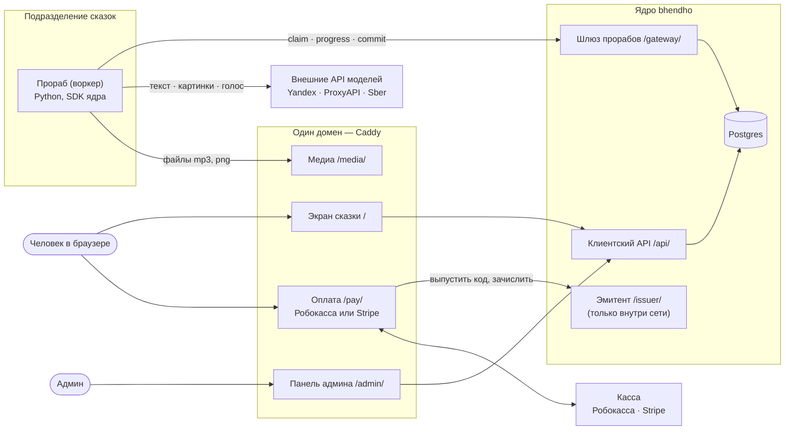

# Мануал: как устроена система

Подробная карта системы для тех, кто её не знает: что где лежит в коде, какие это компоненты, как идут процессы.
Две части:

- [bhendho/](bhendho/) — **ядро**: пользователи, деньги, бланки, факты, задачи, шлюз прорабов, SDK.
- [tale/](tale/) — **система сказок** (`orb-tale-*`): подразделение сказок, воркер, путь сказки до внешнего API,
  оплата, сборка.

Начните с [карты кода](map.md): там все репозитории, каталоги и файлы, у каждого одна строка «что здесь».

Версии, по которым написан мануал: ядро `bhendho` — тег `v0.3.1`, репозитории `orb-tale-*` — `main` на
2026-10-17. Ссылки на код ведут на GitHub на эти версии. `make test` проверяет, что каждый названный путь
существует, а каждая схема собирается.

## Всё сразу

## С чего начать

**Разработчику воркера** (пишет прораба, бланки, подключает модели):

1. [Глоссарий](bhendho/01-glossary.md) — слова системы.
2. [Путь одной сказки через код](tale/05-task-path.md) — от кнопки до внешнего API и обратно.
3. [Шлюз прорабов](bhendho/07-gateway.md) и [SDK прораба](bhendho/08-sdk-python.md) — с чем работает прораб.
4. [Паспорт и бланки](bhendho/09-passport-and-blanks.md) — как объявить работу и данные.
5. [Устройство воркера](tale/04-worker-map.md), [конвейер](tale/06-pipeline.md),
   [провайдеры](tale/07-providers.md), [счёт](tale/09-accounting.md).
6. [Рецепты](tale/14-recipes.md) — типовые изменения по шагам.

**Аналитику** (нужна картина целиком):

1. [Обзор ядра](bhendho/00-overview.md) и [обзор системы сказок](tale/00-overview.md).
2. [Данные](bhendho/03-data.md), [деньги](bhendho/04-money.md), [задачи](bhendho/06-tasks.md).
3. [Путь человека и сказки](tale/05-task-path.md), [оплата](tale/11-payments.md).
4. [Карта решений (ADR)](bhendho/15-adr-map.md) и [чего нет](tale/15-gaps.md).

## Как читать главу

Каждая глава устроена одинаково:

1. **Зачем это** — две-три строки.
2. **Схема** — mermaid; GitHub рисует её прямо в файле.
3. **Как устроено** — словами.
4. **Где в коде** — таблица «файл → функция или класс → что делает», ссылки на GitHub.
5. **Как проверить** — тест или команда.

Термины едины по [глоссарию](bhendho/01-glossary.md). Имя из кода дано рядом: «бланк (`form`)».
