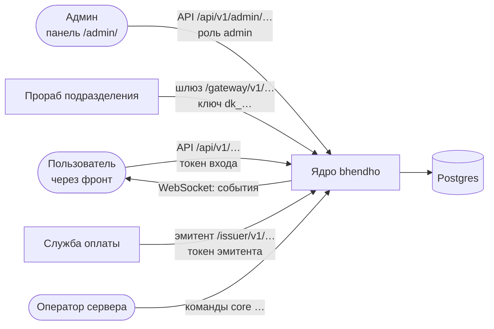
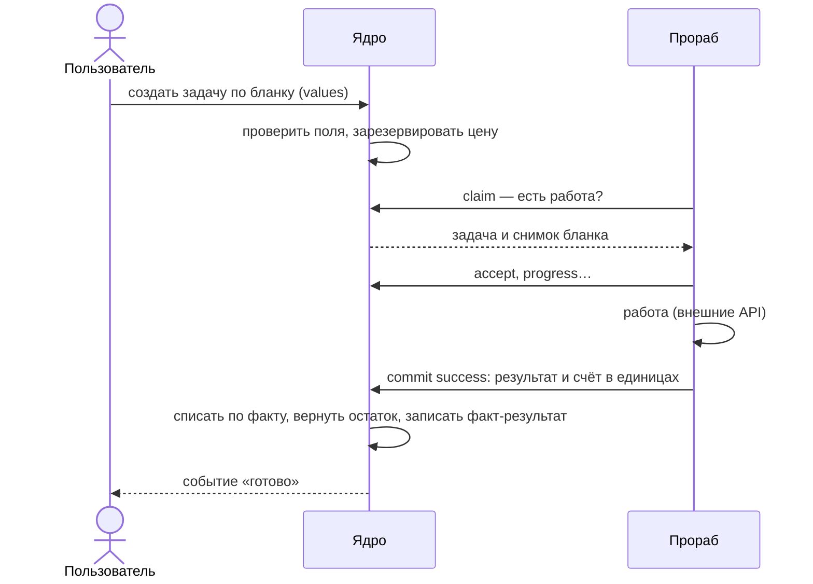

# Ядро: обзор

**Зачем это.** Ядро `bhendho` — общая часть любой сферы услуг. Оно ведёт людей и их деньги, хранит данные и
раздаёт работу исполнителям. Сказки, оплата и всё будущее — **подразделения**: они подключаются к ядру снаружи.

## Что ядро знает и чего не знает

| Знает | Не знает |
|---|---|
| пользователей, роли, вход | что такое сказка, герой, страница |
| кошельки в GC, резерв, списание, минус | сколько стоит модель Яндекса |
| бланки (`form`) — формы данных и работы, их поля и цены | что значат поля бланка |
| факты (`fact`) — данные пользователя по версиям | как нарисовать карточку факта — это разметка подразделения |
| задачи (`task`) — работа за деньги, её очередь и исход | как выполнить работу — это прораб |
| подразделения, их ключи, прорабов и приоритеты | какие внешние API зовёт прораб |
| промокоды и метки «Пополнить» | какая касса принимает деньги — это служба оплаты |

Отсюда главное правило: **подразделение говорит с ядром только через контракты** — паспорт, бланки, шлюз
прорабов, эмитент, разметку. Ядро никогда не зовёт подразделение само: прораб приходит за работой
(`claim`), служба оплаты — выпустить код.

## Кто с ядром говорит

| Кто | Чем входит | Что делает | Глава |
|---|---|---|---|
| пользователь | токен после входа | заполняет бланки, запускает задачи, видит факты и кошелёк | [06-tasks](06-tasks.md), [05-facts](05-facts.md) |
| админ | тот же вход, роль `admin` | ключи подразделений, тарифы, витрина, выгрузка | [10-front](10-front.md) |
| прораб | ключ подразделения `dk_…` | подключает паспорт, берёт задачи, сдаёт отчёт | [07-gateway](07-gateway.md), [08-sdk-python](08-sdk-python.md) |
| служба оплаты | токен эмитента | выпускает промокод на оплату, зачисляет по метке | [11-pay](11-pay.md) |
| оператор | доступ к серверу | роли, миграции, проверка паспорта | [14-operations](14-operations.md) |

## Одна задача — коротко

Подробно — [06-tasks](06-tasks.md), со стороны прораба — [07-gateway](07-gateway.md), на примере сказки —
[tale/05-task-path](../tale/05-task-path.md).

## Где в коде

| Что | Где |
|---|---|
| вход программы | [cmd/core/main.go](https://github.com/vlad78831457/bhendho/blob/v0.3.0/cmd/core/main.go) |
| логика | [internal/core/engine/](https://github.com/vlad78831457/bhendho/tree/v0.3.0/internal/core/engine) |
| адреса HTTP | [internal/core/httpapi/](https://github.com/vlad78831457/bhendho/tree/v0.3.0/internal/core/httpapi) |
| контракты | [contracts/](https://github.com/vlad78831457/bhendho/tree/v0.3.0/contracts) |
| решения | [docs/specifications/02-decisions.md](https://github.com/vlad78831457/bhendho/blob/v0.3.0/docs/specifications/02-decisions.md) — ADR-01…77, карта — [15-adr-map](15-adr-map.md) |

Полный список файлов — [карта кода](../map.md#bhendho--ядро).
