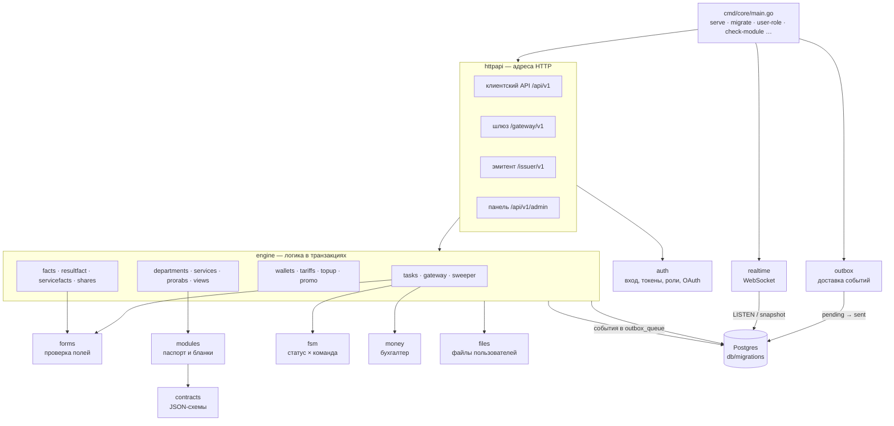

# Устройство ядра

**Зачем это.** Ядро — одна программа на Go (`core`) и одна база Postgres. Здесь видно, из каких частей
программа состоит, кто кого вызывает и что работает в фоне.

## Части и связи

**Вся логика — в `engine`.** Каждый вызов, меняющий данные, — одна транзакция Postgres. Задача, резерв и
событие пользователю пишутся вместе или не пишутся вовсе. `httpapi` только разбирает запрос, проверяет доступ и
зовёт `engine`.

## Запуск `core serve`

Порядок — функция `serve` в `cmd/core/main.go`:

1. Конфигурация из переменных `CORE_…` и соединение с базой; миграции.
2. Загрузить JSON-схемы контрактов (`contracts.Load`).
3. Собрать `realtime.Hub` и `engine.Engine`. Если задан `CORE_STORAGE_DIR` — подключить хранилище файлов.
4. **По желанию**, для старого способа и тестов:
   - модули с диска (`CORE_MODULES_DIR`);
   - прорабы из `CORE_PRORAB_TOKENS`.

   Обычно подразделения подключаются сами, по ключу ([07-gateway](07-gateway.md)).
5. Эмитенты оплаты из `CORE_PROMO_ISSUERS` (`имя:токен`).
6. Три фоновые работы:
   - `hub.Listen` — события в WebSocket;
   - `outbox.Run` — доставка очереди событий;
   - `eng.RunBackground` — уборщик истёкших блокировок и чистка старого.
7. HTTP-сервер на `CORE_HTTP_ADDR`.

## Фоновые работы

| Работа | Как часто | Что делает | Где |
|---|---|---|---|
| уборщик | `CORE_SWEEP_INTERVAL` | задачи `processing` с истёкшей блокировкой: вернуть в очередь или, если попытки кончились, отказ `LIMIT_EXHAUSTED` | `SweepExpired` в [sweeper.go](https://github.com/vlad78831457/bhendho/blob/v0.3.0/internal/core/engine/sweeper.go) |
| чистка | раз в час | старые записи трассы (`CORE_TRACE_TTL`), старые задачи (`CORE_TASK_RETENTION`), неиспользованные метки «Пополнить» | `Cleanup` там же |
| доставка событий | `CORE_OUTBOX_INTERVAL`, пачками по `CORE_OUTBOX_BATCH` | события из `outbox_queue` → номер `seq` → отправлено | [outbox.go](https://github.com/vlad78831457/bhendho/blob/v0.3.0/internal/core/outbox/outbox.go) |
| WebSocket | постоянно | подписка пользователя: снимок, затем догоняющие события по `seq` | [realtime.go](https://github.com/vlad78831457/bhendho/blob/v0.3.0/internal/core/realtime/realtime.go) |

## Где в коде

| Пакет | Что | Главное |
|---|---|---|
| [cmd/core](https://github.com/vlad78831457/bhendho/blob/v0.3.0/cmd/core/main.go) | вход, подкоманды | `serve`, `migrate`, `user-role`, `check-module`, `promo-codes`, `healthz` |
| [engine](https://github.com/vlad78831457/bhendho/tree/v0.3.0/internal/core/engine) | логика | `Engine`; по файлам — [карта кода](../map.md#файлы-engine--где-какая-логика) |
| [httpapi](https://github.com/vlad78831457/bhendho/blob/v0.3.0/internal/core/httpapi/httpapi.go) | адреса | маршруты всех потоков, проверка токенов; карта — [12-api](12-api.md) |
| [auth](https://github.com/vlad78831457/bhendho/tree/v0.3.0/internal/core/auth) | вход | пароли argon2id, токены, роли, OAuth |
| [forms](https://github.com/vlad78831457/bhendho/blob/v0.3.0/internal/core/forms/forms.go) | поля | проверка `values` по `fields_rules` |
| [modules](https://github.com/vlad78831457/bhendho/blob/v0.3.0/internal/core/modules/modules.go) | паспорт | `Load`, `Parse`, проверка разметки `checkViews` |
| [fsm](https://github.com/vlad78831457/bhendho/blob/v0.3.0/internal/core/fsm/fsm.go) | автомат задачи | `Allowed`, `Envelope` |
| [money](https://github.com/vlad78831457/bhendho/blob/v0.3.0/internal/core/money/accountant.go) | бухгалтер | `Settle` — счёт в единицах → GC с крышкой |
| [contracts](https://github.com/vlad78831457/bhendho/blob/v0.3.0/internal/core/contracts/contracts.go) | схемы | проверка паспорта и конвертов по JSON-схемам |
| [config](https://github.com/vlad78831457/bhendho/blob/v0.3.0/internal/core/config/config.go) | настройки | все числа ядра; список — [14-operations](14-operations.md) |
| [codes](https://github.com/vlad78831457/bhendho/blob/v0.3.0/internal/core/codes/codes.go) | коды отказа | единый реестр: `VALIDATION_ERROR`, `INSUFFICIENT_FUNDS`, `DATA_REJECTED`… |
| [files](https://github.com/vlad78831457/bhendho/tree/v0.3.0/internal/core/files) | файлы | приём картинок, хранилище, подписанные ссылки |
| [db](https://github.com/vlad78831457/bhendho/blob/v0.3.0/internal/core/db/db.go) | база | пул соединений, встроенные миграции |

## Как проверить

- `make test` в `bhendho`: Go-тесты, в том числе сквозные `httpapi/*_e2e_test.go` на настоящей базе в Docker.
- `docker compose exec core /core healthz` — отвечает ли HTTP.
