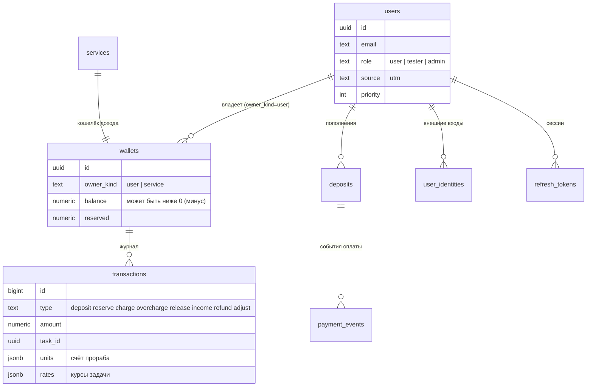
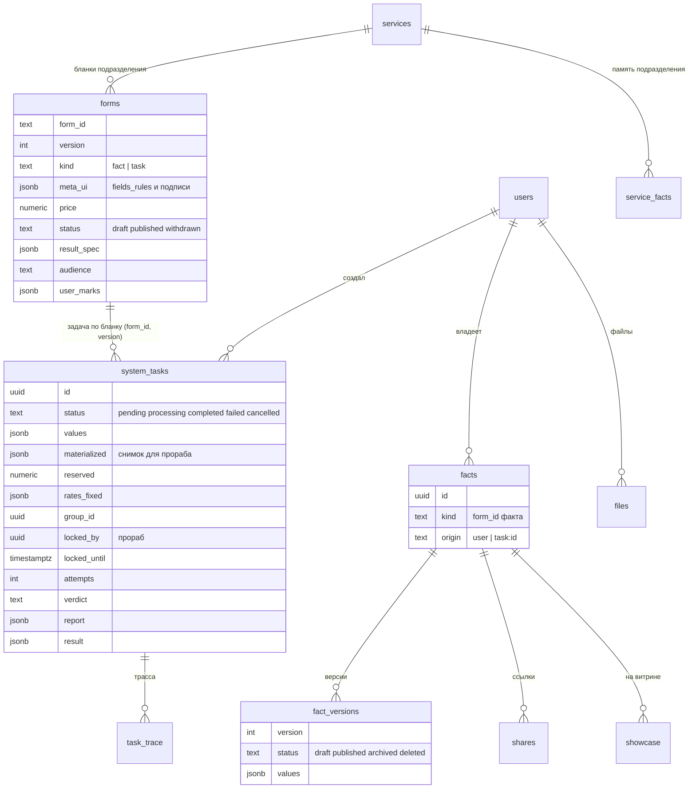
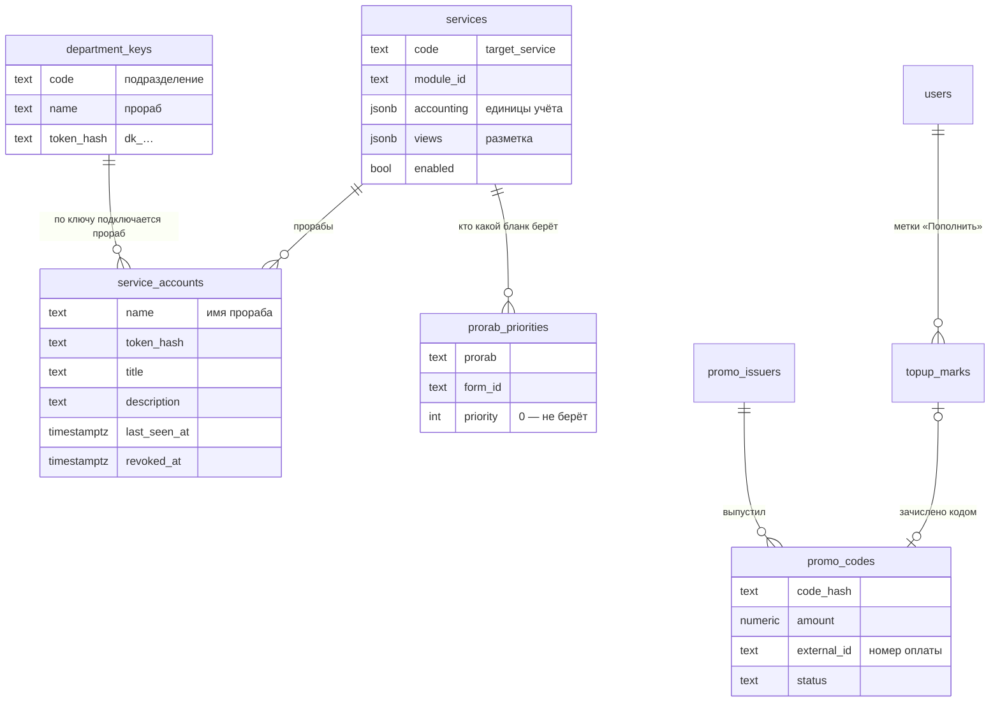

# Данные

**Зачем это.** Всё состояние системы — в одной базе Postgres. Здесь таблицы ядра по группам и связи между ними.
Схема строится 21 миграцией — [db/migrations/](https://github.com/vlad78831457/bhendho/tree/v0.3.1/internal/core/db/migrations),
от `0001_core.sql` до `0021_prorab_info.sql`. Ядро запускает их само при старте.

Подразделения своей базы в ядре не имеют. Их данные — факты пользователей и память подразделения
(`service_facts`).

## Люди и деньги

## Бланки, факты, задачи

## Подразделения, прорабы, оплата

## Служебные таблицы

| Таблица | Что | Миграция |
|---|---|---|
| `outbox_queue` | события пользователю, ждущие доставки (`pending` → `sent`, номер `seq`) | 0001 |
| `user_seq` | последний номер события пользователя | 0001 |
| `task_trace` | трасса задачи: этапы, кто, код | 0001 |
| `currencies` | валюты, по умолчанию `GC` | 0001 |
| `tariff_changes` и вид `tariffs` | журнал правок тарифов и последнее действующее значение | 0014 |
| `oauth_states`, `oauth_logins` | одноразовые шаги входа через внешний аккаунт | 0005 |
| `promo_failures` | неудачные попытки ввода кода, против подбора | 0004 |

## Что когда появилось

| Миграция | Что |
|---|---|
| 0001 | ядро: пользователи, кошельки, проводки, бланки, факты, задачи, подразделения, события, файлы |
| 0002 | факт-результат задачи (`result_spec`) |
| 0004 | промокоды и эмитенты |
| 0005–0006 | внешние входы, кабинет |
| 0007 | размеры картинок |
| 0008 | роли |
| 0009 | метки «Пополнить» |
| 0010 | минус: баланс может быть ниже нуля, проводка `overcharge` |
| 0011–0013 | память подразделения, «кому», пометки пользователя в снимке задачи |
| 0014 | тарифы |
| 0015–0016 | ключи подразделений, выключатель, разметка |
| 0017–0019 | ссылки «поделиться», витрина, метка источника |
| 0020–0021 | приоритеты и сведения о прорабах |

## Как проверить

- Таблицы на живой системе:
  `docker compose -f deploy/compose.yaml exec postgres psql -U offgrid -d offgrid -c '\dt'`.
- Выгрузка всей базы за период из панели — ZIP с файлом на таблицу ([10-front](10-front.md)).
