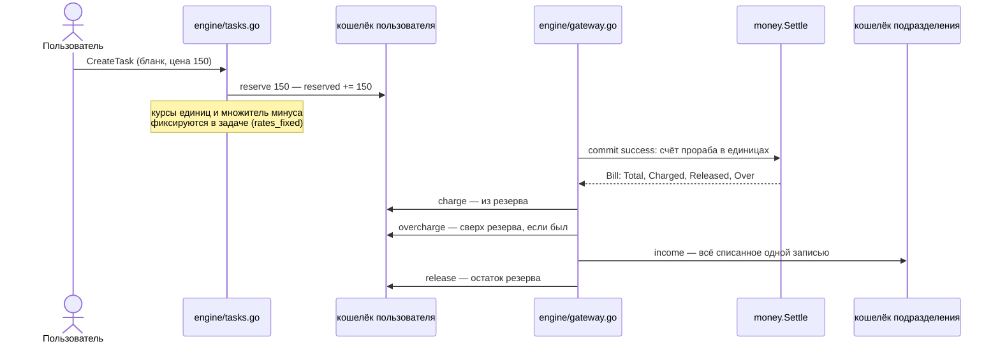

# Деньги

**Зачем это.** Пользователь платит за работу подразделения во внутренней валюте GC. Ядро откладывает цену при
запуске, списывает по факту по счёту прораба и возвращает остаток. Каждое движение — запись в журнале,
журнал только дописывается.

## Путь денег одной задачи

Если задача не удалась (`failTask`), резерв возвращается целиком (`releaseReserve`).

## Как считается списание

Прораб присылает счёт в своих единицах: строки `{unit, units}`. Бухгалтер `money.Settle`:

1. переводит каждую единицу в **основную**:
   - основная — `base_unit`, коэффициент 1;
   - дополнительные — с коэффициентом `rate_to_base`;
2. сумма основных единиц × `rate_gc` = **факт** (`Total`), в GC;
3. **списано** (`Charged`) = меньшее из факта и резерва × множитель минуса;
4. **сверх резерва** (`Over`) = списано − резерв, если больше нуля;
5. **возврат** (`Released`) = резерв − списано, если больше нуля.

Если в паспорте нет единиц учёта, цена фиксированная: списывается ровно резерв.

### Пример — сказка

В паспорте сказок ([module.yaml](https://github.com/vlad78831457/orb-tale-servo/blob/main/worker/module/module.yaml)):
- основная единица — `tokens`, 1 токен = 0,0005 GC;
- дополнительные: `images` = 8000 токенов, `tts_seconds` = 40 токенов;
- цена бланка «Начать сказку» — 150 GC.

Прораб на заглушках прислал счёт на 26 321 основную единицу:

| Шаг | Значение |
|---|---|
| факт | 26 321 × 0,0005 = 13,1605 GC |
| крышка | 150 × 1,5 = 225 GC |
| списано | min(13,1605; 225) = 13,1605 |
| возврат | 150 − 13,1605 = 136,8395 |

Так на скриншоте кабинета: резерв 150, списание −13,1605, возврат +136,8395.

## Минус

С ADR-63 списание может быть до `резерв × CORE_OVERDRAFT_FACTOR`; по умолчанию 1,5. Часть сверх резерва берётся
из баланса, и баланс может уйти ниже нуля (миграция 0010 сняла запрет). Кошелёк в минусе не берёт **никаких**
новых задач, даже бесплатных: `insertTask` отказывает с `INSUFFICIENT_FUNDS`.

Множитель запоминается в задаче при создании. Правка в «Тарифах» действует только на новые задачи.

## Тарифы

Админ меняет в панели ([tariffs.go](https://github.com/vlad78831457/bhendho/blob/v0.3.0/internal/core/engine/tariffs.go), ADR-69):

| Что | Ключ | Действует |
|---|---|---|
| цена бланка задачи (резерв) | бланк | сразу: каталог, шаблон, новые задачи |
| курс единицы подразделения | `<подразделение>:<единица>` | для новых задач |
| множитель минуса | — | для новых задач |

Журнал `tariff_changes` только дописывается. Действует последняя запись. `null` — вернуть значение из паспорта
или настроек («Как в паспорте»). Повторная регистрация паспорта журнал не трогает.

## Виды проводок

| `type` | Кошелёк | Когда |
|---|---|---|
| `deposit` | пользователя | пополнение: демо, промокод |
| `reserve` | пользователя | создание задачи |
| `charge` | пользователя | списание в пределах резерва |
| `overcharge` | пользователя | списание сверх резерва |
| `release` | пользователя | возврат остатка резерва или всего резерва при отказе |
| `income` | подразделения | доход за задачу, одной записью |
| `refund`, `adjust` | любой | возврат и ручная правка (зарезервированы схемой) |

У проводки есть `units` и `rates` — счёт прораба и курсы. По журналу можно восстановить, за что списано.

## Где в коде

| Файл | Функция | Что |
|---|---|---|
| [engine/tasks.go](https://github.com/vlad78831457/bhendho/blob/v0.3.0/internal/core/engine/tasks.go) | `insertTask` | резерв, проверка «хватает ли», фиксация курсов и множителя |
| [engine/tasks.go](https://github.com/vlad78831457/bhendho/blob/v0.3.0/internal/core/engine/tasks.go) | `failTask`, `releaseReserve` | отказ и возврат резерва |
| [engine/gateway.go](https://github.com/vlad78831457/bhendho/blob/v0.3.0/internal/core/engine/gateway.go) | `settle` | расчёт по отчёту, проводки `charge`, `overcharge`, `income`, `release` |
| [money/accountant.go](https://github.com/vlad78831457/bhendho/blob/v0.3.0/internal/core/money/accountant.go) | `Settle`, `Rates`, `Bill` | формула выше |
| [engine/wallets.go](https://github.com/vlad78831457/bhendho/blob/v0.3.0/internal/core/engine/wallets.go) | `Wallets`, `Transactions`, `DemoDeposit` | кошелёк и история для фронта, демо-пополнение |
| [engine/tariffs.go](https://github.com/vlad78831457/bhendho/blob/v0.3.0/internal/core/engine/tariffs.go) | — | тарифы |

## Как проверить

- Тесты ядра: [overdraft_test.go](https://github.com/vlad78831457/bhendho/blob/v0.3.0/internal/core/engine/overdraft_test.go), [tariffs_test.go](https://github.com/vlad78831457/bhendho/blob/v0.3.0/internal/core/engine/tariffs_test.go).
- `make e2e` в `orb-tale-eco`: «списано по факту, осталось … GC».
- Руками: кабинет → «Баланс и история».
