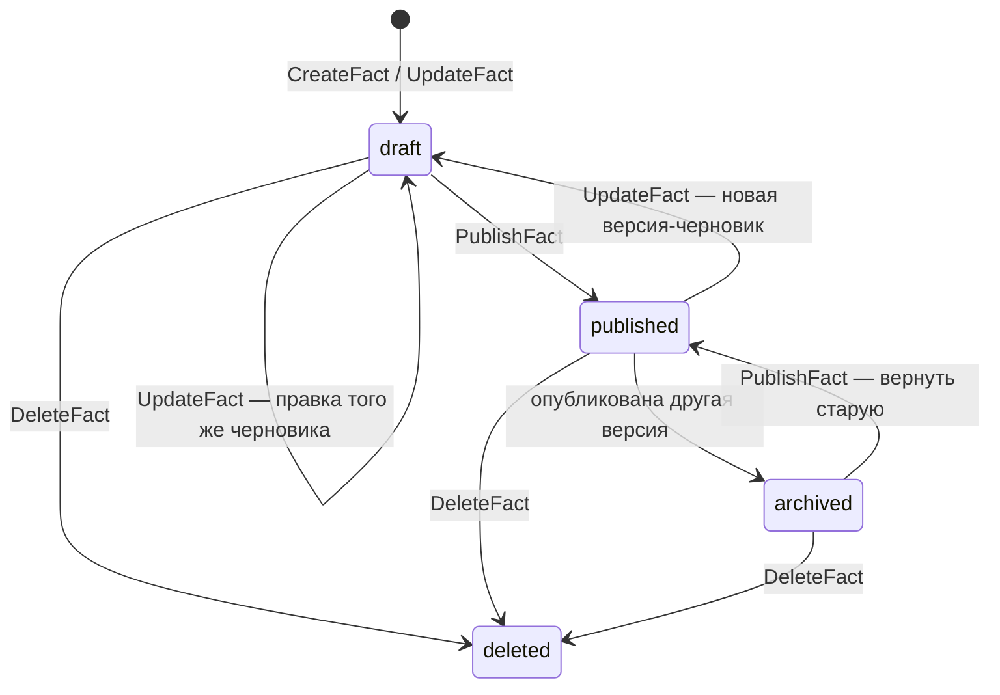
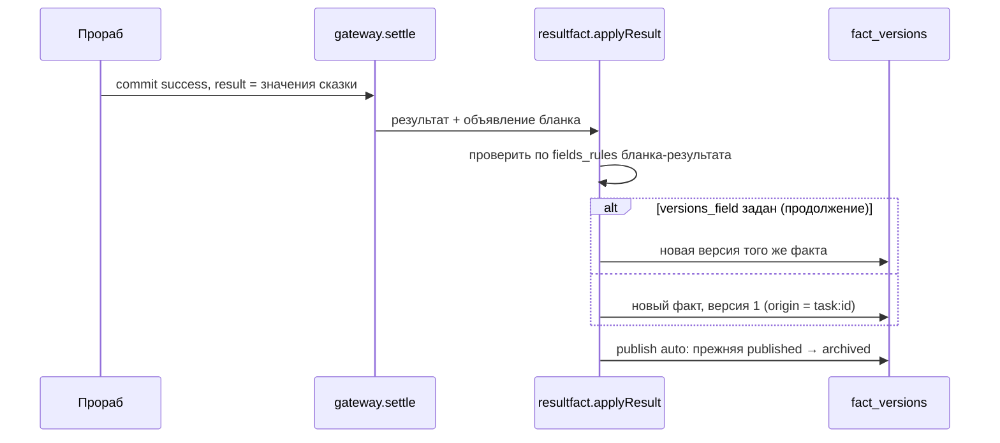

# Факты и версии

**Зачем это.** Факт — данные пользователя: герой, сказка, анкета. Факт никогда не переписывается. Каждое
изменение — новая версия, у каждой версии свой статус. Задача ссылается на факт, а прораб получает **снимок**
версии. Поэтому изменения после запуска задачи её не ломают.

## Жизнь версии

- **`UpdateFact`.** Последняя версия — черновик: правится он же. Иначе появляется новая версия-черновик.
- **`PublishFact`.** Публикует черновик или архивную версию. Прежняя опубликованная уходит в `archived`.
  Опубликованная может быть только одна.
- **`DeleteFact`.** Помечает `deleted` все версии. Ссылки не мешают: снимки задач хранят значения у себя.
- Задача может сослаться только на **опубликованный** факт нужного вида: поле `fact_ref`,
  проверка `checkTaskRefs`.

## Факт как результат задачи

Бланк задачи может объявить результат (`result` в паспорте, ADR-51):

| Поле | Что |
|---|---|
| `fact_kind` | бланк факта, который получится; должен быть опубликован |
| `versions_field` | поле `fact_ref` бланка задачи. Если задано, результат — **новая версия** этого факта, а не новый факт |
| `publish` | `auto` — версия сразу опубликована (прежняя → `archived`), `draft` — черновик |

Результат прораба проверяется **теми же правилами полей**, что ввод человека. Не прошёл — задача не
засчитывается. Так сказка растёт версиями: старт — факт v1, каждое продолжение — v2, v3… Последняя опубликована,
прежние в архиве.

## «Кому» и память подразделения

У бланка факта есть `audience` (ADR-65):
- `user` (по умолчанию) — факт пользователя, он его видит;
- **любое другое слово** — факт в **памяти подразделения** (`service_facts`). Пользователь его не видит ни при
  каком исходе.

Прораб присылает такие факты в отчёте (`report.service_facts`). Ядро проверяет все до записи результата, а
сохраняет только при успехе задачи — все или ни одного. Админ видит их в панели и может записать факт сам.
Так подразделение хранит, например, маски или настройки, не заводя своей базы.

## Поделиться

`CreateShare` даёт ссылку `sh_…` на **конкретную версию**. По ссылке факт открывается без входа
(`Shared`), поисковикам закрыт. Другой вошедший человек может сохранить копию (`CopyShared`) — это его новый
факт, оригинал не меняется. Владелец отзывает ссылку (`RevokeShare`). В базе хранится только хэш ссылки.

## Где в коде

| Файл | Функция | Что |
|---|---|---|
| [engine/facts.go](https://github.com/vlad78831457/bhendho/blob/v0.3.1/internal/core/engine/facts.go) | `CreateFact`, `UpdateFact`, `PublishFact`, `DeleteFact`, `GetFact`, `ListFacts` | версии и статусы |
| [engine/resultfact.go](https://github.com/vlad78831457/bhendho/blob/v0.3.1/internal/core/engine/resultfact.go) | `applyResult` | результат задачи → факт или версия |
| [engine/servicefacts.go](https://github.com/vlad78831457/bhendho/blob/v0.3.1/internal/core/engine/servicefacts.go) | `prepareServiceFacts` | память подразделения из отчёта |
| [engine/shares.go](https://github.com/vlad78831457/bhendho/blob/v0.3.1/internal/core/engine/shares.go) | `CreateShare`, `Shared`, `CopyShared`, `RevokeShare` | ссылки и копии |
| [forms/forms.go](https://github.com/vlad78831457/bhendho/blob/v0.3.1/internal/core/forms/forms.go) | — | проверка значений по `fields_rules` |

## Как проверить

- Тесты: [resultfact_test.go](https://github.com/vlad78831457/bhendho/blob/v0.3.1/internal/core/engine/resultfact_test.go),
  [servicefacts_test.go](https://github.com/vlad78831457/bhendho/blob/v0.3.1/internal/core/engine/servicefacts_test.go),
  [shares_e2e_test.go](https://github.com/vlad78831457/bhendho/blob/v0.3.1/internal/core/httpapi/shares_e2e_test.go).
- E2E сказки: `published_version == 3`, версии `published, archived, archived`
  ([test_tale_e2e.py](https://github.com/vlad78831457/orb-tale-servo/blob/main/worker/tests/e2e/test_tale_e2e.py)).
