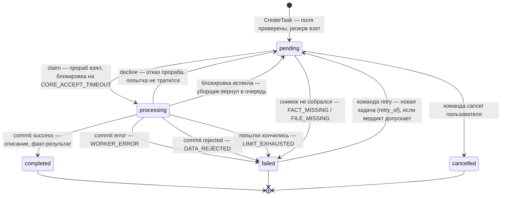
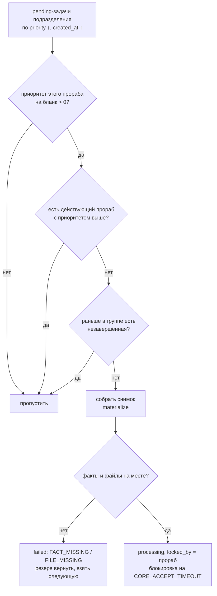

# Задачи

**Зачем это.** Задача — одна работа за деньги: «напиши сказку», «продолжи». Ядро принимает её у пользователя,
откладывает деньги и держит в очереди. Оно отдаёт задачу прорабу, следит за сроком, засчитывает исход и
сообщает пользователю. Как выполнить работу, ядро не знает.

## Состояния

В схеме есть ещё статусы `draft` и `template` (заготовки), но в этом процессе они не участвуют.

**Команды пользователя** — матрица в [fsm.go](https://github.com/vlad78831457/bhendho/blob/v0.3.1/internal/core/fsm/fsm.go):
- `cancel` — только из `pending`;
- `retry` — только из `failed`, и только если вердикт по вине исполнения (`codes.Retryable`). После
  `DATA_REJECTED` повтора нет: менять надо данные.

Фронт не решает это сам: в ответе о задаче поле `commands` говорит, какие кнопки активны (`fsm.Envelope`).

## Создание — `CreateTask`

1. Нужен ключ идемпотентности: повтор того же запроса вернёт ту же задачу.
2. Бланк задачи опубликован. Значения проходят `fields_rules` (`forms`).
3. Ссылки на факты (`fact_ref`) — на **опубликованные** факты нужного вида; файлы живы (`checkTaskRefs`).
4. `insertTask`:
   - кошелёк не в минусе и доступно ≥ цена бланка, иначе `INSUFFICIENT_FUNDS`;
   - **резерв** цены;
   - фиксация курсов единиц и множителя минуса;
   - группа: задачи одного `group_id` идут по порядку `group_pos`, группа — одного пользователя;
   - строка `system_tasks` со статусом `pending` и приоритетом пользователя.
5. Событие пользователю (`task.status`) — в той же транзакции.

## Выдача прорабу — `Claim`

Прораб спрашивает работу своего подразделения (`target_service`) и версий бланков, которые умеет. Ядро берёт
первую подходящую задачу (`FOR UPDATE SKIP LOCKED`), порядок: приоритет задачи ↓, время создания ↑.

Подходит задача, если одновременно:

| Условие | Зачем |
|---|---|
| `status = pending`, подразделение включено | выключенное подразделение задач не получает, они ждут |
| приоритет этого прораба на бланк > 0 (нет записи — 1) | `0` — прораб этот бланк не берёт |
| нет **действующего** прораба с приоритетом выше | действующий — не отозван и был на связи последние 2 минуты |
| в группе нет незавершённой задачи раньше этой | продолжения сказки строго по очереди |

**Снимок** (`materialized`) — самодостаточный конверт: значения бланка, тела опубликованных версий фактов по
ссылкам, описания файлов. Ссылки внутри фактов не раскрываются вглубь. Байты файлов прораб берёт отдельно,
по задаче. Подробно — [07-gateway](07-gateway.md).

## Исполнение и срок

| Шаг прораба | Что делает ядро |
|---|---|
| `accept` с ETA | попытка +1. Блокировка = ETA × `CORE_LOCK_MULTIPLIER` (3), но не дольше `CORE_LOCK_CEILING`. Без ETA — среднее по последним 100 задачам или `CORE_DEFAULT_ETA` |
| `decline` | задача обратно в очередь, попытка не тратится |
| `heartbeat` | «жив»; в ответе — текущее состояние, например «отменена» |
| `progress` | процент и фаза — пользователю сразу, в базу не пишется |
| `commit` | исход: `success` → `settle`, `error` → `WORKER_ERROR`, `rejected` → `DATA_REJECTED`; неизвестный → `REPORT_INVALID` |

**Уборщик** (`SweepExpired`, каждые `CORE_SWEEP_INTERVAL`) находит задачи с истёкшей блокировкой.
- Если принятых попыток уже `CORE_MAX_ATTEMPTS` (5), задача получает отказ `LIMIT_EXHAUSTED`, резерв
  возвращается.
- Иначе задача возвращается в `pending`.

Отчёт от прораба, который уже не владеет задачей, молча отбрасывается (`ownedProcessing`). Так двойная сдача
не приводит к двойному списанию.

## Расчёт — `settle`

Одна транзакция:
1. проверить память подразделения из отчёта;
2. записать факт-результат ([05-facts](05-facts.md));
3. посчитать счёт ([04-money](04-money.md)) и проводки;
4. `completed`, вердикт `SUCCESS`;
5. событие пользователю.

Если результат не прошёл проверку, задача не засчитывается.

## События пользователю

Каждое изменение пишет событие в `outbox_queue` в той же транзакции (`emit`): `task.status`, `task.progress`,
кошелёк. Доставщик `outbox` нумерует их `seq`, `realtime` отдаёт по WebSocket. Фронт держит последний `seq` и после
обрыва догоняет пропущенное.

## Где в коде

| Файл | Функция | Что |
|---|---|---|
| [engine/tasks.go](https://github.com/vlad78831457/bhendho/blob/v0.3.1/internal/core/engine/tasks.go) | `CreateTask`, `insertTask`, `checkTaskRefs`, `Command`, `failTask`, `GetTask`, `ListTasks` | создание, команды, отказ |
| [engine/gateway.go](https://github.com/vlad78831457/bhendho/blob/v0.3.1/internal/core/engine/gateway.go) | `Claim`, `materialize`, `Accept`, `Heartbeat`, `Progress`, `Commit`, `settle` | работа с прорабом |
| [engine/sweeper.go](https://github.com/vlad78831457/bhendho/blob/v0.3.1/internal/core/engine/sweeper.go) | `SweepExpired`, `Cleanup`, `RunBackground` | срок, попытки, чистка |
| [fsm/fsm.go](https://github.com/vlad78831457/bhendho/blob/v0.3.1/internal/core/fsm/fsm.go) | `Allowed`, `Envelope` | какие команды можно |
| [codes/codes.go](https://github.com/vlad78831457/bhendho/blob/v0.3.1/internal/core/codes/codes.go) | `Retryable` | коды и можно ли повторить |
| [outbox/outbox.go](https://github.com/vlad78831457/bhendho/blob/v0.3.1/internal/core/outbox/outbox.go), [realtime/realtime.go](https://github.com/vlad78831457/bhendho/blob/v0.3.1/internal/core/realtime/realtime.go) | — | доставка событий |

## Как проверить

- Тесты: [engine_test.go](https://github.com/vlad78831457/bhendho/blob/v0.3.1/internal/core/engine/engine_test.go),
  [prorabs_test.go](https://github.com/vlad78831457/bhendho/blob/v0.3.1/internal/core/engine/prorabs_test.go).
- Таблица задач и трасса на живой системе:
  `SELECT status, verdict, attempts FROM system_tasks ORDER BY created_at DESC LIMIT 5;`,
  `SELECT stage, actor, code FROM task_trace WHERE task_id = '…' ORDER BY at;`.
