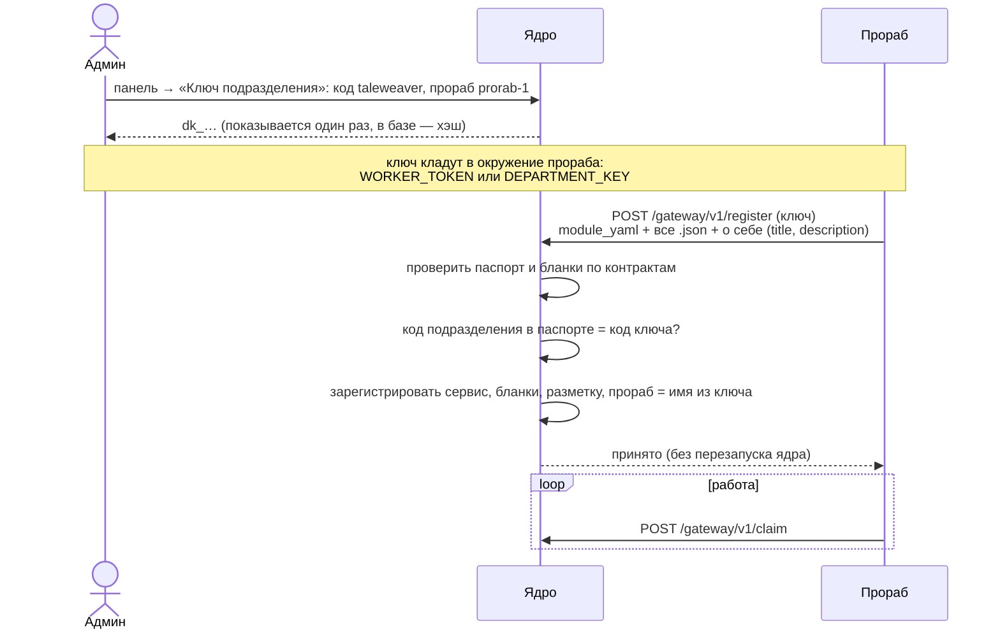
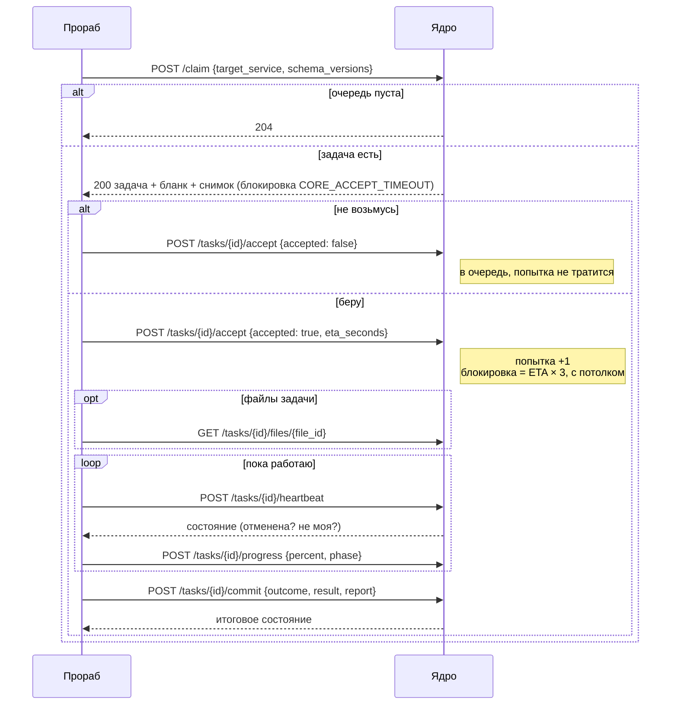

# Шлюз прорабов

**Зачем это.** Шлюз — единственная дверь, через которую подразделение работает с ядром. Прораб (программа
подразделения) подключается ключом, присылает свой паспорт и берёт задачи. Сам ядро прораба не зовёт никогда.
Эту главу нужно знать разработчику воркера. Удобнее работать через [SDK](08-sdk-python.md), он делает всё это
сам.

## Подключение по ключу

- **Ключ выдаётся на пару «код подразделения + имя прораба».**
  - Повторная выдача на ту же пару заменяет ключ: старый перестаёт работать. Так ключ и «отзывают».
  - Чужой паспорт с этим ключом — `403`.
  - Неверный ключ — `401`.
  - Сломанный паспорт — `422`, в ответе причина.
- **Повторная регистрация с новой версией паспорта — обновление.** Ядро не перезапускается; обновить
  подразделение — перезапустить только прораба.
- **Тот же ключ — токен прораба** для всех остальных адресов шлюза.
- **Админ видит прораба в «Подразделениях»:** подпись, описание, когда был на связи. «На связи» обновляется
  при `claim`, не чаще раза в 30 секунд.

## Цикл одной задачи

## Адреса

| Адрес | Тело | Что делает ядро | Функция |
|---|---|---|---|
| `POST /gateway/v1/register` | `module_yaml`, `files`, `prorab{title, description}` | проверяет и регистрирует паспорт | `RegisterDepartment` |
| `POST /gateway/v1/claim` | `target_service`, `schema_versions` | выдаёт задачу по правилам [выбора прораба](06-tasks.md#выдача-прорабу--claim) | `Claim` |
| `POST /gateway/v1/tasks/{id}/accept` | `accepted`, `eta_seconds` | берёт попытку и ставит срок, или возвращает в очередь | `Accept` |
| `POST /gateway/v1/tasks/{id}/heartbeat` | — | отвечает состоянием | `Heartbeat` |
| `POST /gateway/v1/tasks/{id}/progress` | `percent`, `phase` | событие пользователю, мимо базы | `Progress` |
| `POST /gateway/v1/tasks/{id}/commit` | `outcome`, `result`, `report` | засчитывает исход | `Commit` |
| `GET /gateway/v1/tasks/{id}/files/{file_id}` | — | байты файла, только из снимка этой задачи | `httpapi/files.go` |

**Всё, что не «моя задача в работе», ядро не принимает.** Ответ отказа — `409`, его SDK превращает в
`NotOwnerError`. Если задачу отменили, отобрал уборщик или её взял другой прораб, отчёт выбрасывается, денег не
списывается.

## Что приходит в задаче

`ClaimedTask` (типы — [models.py](https://github.com/vlad78831457/bhendho/blob/v0.3.0/pkg/sdk/python/src/offgrid_worker/models.py)):

| Поле | Что |
|---|---|
| `task_id`, `attempt` | номер задачи и попытки |
| `blank.system` | `form_id`, `schema_version`, `target_service`, `attempts`, владелец |
| `blank.meta_ui` | бланк целиком: подписи и `fields_rules` |
| `blank.values` | **снимок**: значения бланка. Поле `fact_ref` раскрыто — вместо id объект факта с `values` опубликованной версии. Поля-файлы — описания (`file_id`, тип, размер); байты — отдельным запросом |
| `blank.user_marks` | пометки пользователя, если бланк их просит: `role`, `source` |

Память подразделения прораб в задаче **не получает**: шлюз её только принимает в отчёте.

## Что отдаёт прораб — `commit`

| `outcome` | Когда | Итог для задачи | Деньги |
|---|---|---|---|
| `success` | работа сделана | `completed`, `SUCCESS`, факт-результат | списание по счёту, остаток вернуть |
| `error` | сбой исполнения: модель упала, таймаут | `failed`, `WORKER_ERROR`; пользователь может повторить | резерв вернуть |
| `rejected` | данные корректны по форме, но неприменимы по смыслу: «сказка уже завершена» | `failed`, `DATA_REJECTED`; повтора нет | резерв вернуть |

В `report`:
- `worker_charge` — счёт в единицах ([04-money](04-money.md));
- `service_facts` — факты в память подразделения;
- `admin_message` — причина для админа, пользователю не показывается;
- любые свои поля: объяснение, доказательства.

`result` — значения бланка-результата, их проверяют правила полей ([05-facts](05-facts.md)).

## Где в коде

| Файл | Функция | Что |
|---|---|---|
| [engine/departments.go](https://github.com/vlad78831457/bhendho/blob/v0.3.0/internal/core/engine/departments.go) | `IssueDepartmentKey`, `RegisterDepartment`, `SetServiceEnabled`, `DepartmentKeys` | ключи, регистрация, выключатель |
| [engine/gateway.go](https://github.com/vlad78831457/bhendho/blob/v0.3.0/internal/core/engine/gateway.go) | `Claim`, `materialize`, `Accept`, `Heartbeat`, `Progress`, `Commit`, `settle` | цикл задачи |
| [engine/prorabs.go](https://github.com/vlad78831457/bhendho/blob/v0.3.0/internal/core/engine/prorabs.go) | — | приоритеты, «кто есть кто» |
| [httpapi/departments.go](https://github.com/vlad78831457/bhendho/blob/v0.3.0/internal/core/httpapi/departments.go) | — | адрес `register` |
| [httpapi/httpapi.go](https://github.com/vlad78831457/bhendho/blob/v0.3.0/internal/core/httpapi/httpapi.go) | — | адреса шлюза, проверка ключа |
| [contracts/interfaces/worker_gateway.openapi.yaml](https://github.com/vlad78831457/bhendho/blob/v0.3.0/contracts/interfaces/worker_gateway.openapi.yaml) | — | контракт шлюза |

> **Расхождение.** `POST /gateway/v1/register` есть в ядре и тестах, но в контракте `worker_gateway.openapi.yaml`
> его нет: там только `claim`, `accept`, `heartbeat`, `progress`, `commit` и файлы. Описание выше — по коду.
> Дописать контракт — PR в `bhendho` после решения директора.

## Как проверить

- Тест подключения: [departments_e2e_test.go](https://github.com/vlad78831457/bhendho/blob/v0.3.0/internal/core/httpapi/departments_e2e_test.go)
  — неверный ключ, чужой паспорт, сломанный паспорт, успех, задача без перезапуска.
- `make e2e` в `orb-tale-eco`: прораб сказок подключается по ключу из панели; перезапуск только прораба.
