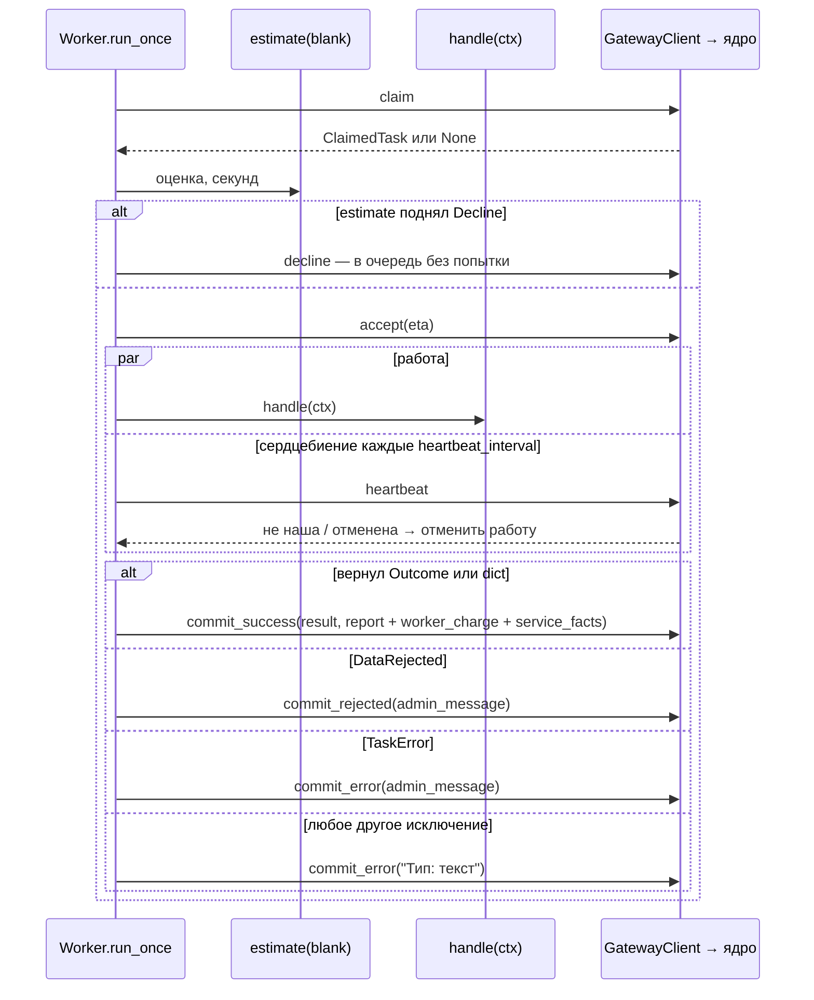

# SDK прораба (Python)

**Зачем это.** SDK `offgrid_worker` берёт на себя всё общее: очередь, сроки, сердцебиение, повторы при сбоях
сети, отчёт. Разработчик пишет одну функцию — **обработчик** (`handle`): получает снимок бланка, делает работу,
считает расход в своих единицах и возвращает результат.

SDK берут из ядра по тегу, в Dockerfile воркера (`BHENDHO_SDK_REF`). Код —
[pkg/sdk/python/src/offgrid_worker/](https://github.com/vlad78831457/bhendho/tree/v0.3.0/pkg/sdk/python/src/offgrid_worker).

## Самый короткий прораб

Из заготовки подразделения ([templates/department/worker/src/department/main.py](https://github.com/vlad78831457/bhendho/blob/v0.3.0/templates/department/worker/src/department/main.py)):

```python
async def handle(ctx: TaskContext) -> Outcome:
    values = ctx.values                                  # снимок бланка
    name = str(values["note"]["values"]["name"])         # fact_ref раскрыт: values опубликованной версии
    text = " ".join([name] * int(values.get("repeat") or 1))[:200]
    ctx.charge("chars", len(text))                       # счёт в своих единицах
    ctx.charge("calls", 1)
    ctx.remember("example.spend.v1", {"chars": len(text)})   # в память подразделения
    return Outcome(result={"name": text})                # значения бланка-результата

async def run() -> None:
    async with GatewayClient(os.environ["CORE_URL"], os.environ["DEPARTMENT_KEY"]) as client:
        await client.register(MODULE_DIR)                # паспорт и бланки — в ядро
        cfg = WorkerConfig(target_service="example", schema_versions=[1], concurrency=2)
        await Worker(client, cfg, handle, estimate=lambda blank: 5).run()
```

## Что делает `Worker` за вас



- **`run()`** крутит `concurrency` параллельных слотов. Пустая очередь — пауза от `poll_interval` до
  `max_poll_interval`. Сбой сети или шлюза — пауза и снова. Неверный ключ (`UnauthorizedError`) — остановка:
  это не лечится повтором.
- **`stop()`** — мягкая остановка: текущие задачи доделываются, новые не берутся.

## Что видит обработчик — `TaskContext`

| Член | Что |
|---|---|
| `values` | снимок бланка: значения, раскрытые `fact_ref`, описания файлов |
| `blank` | конверт целиком: `system`, `meta_ui` (бланк с `fields_rules`), `user_marks` |
| `form_id`, `schema_version` | какой бланк пришёл; один прораб может вести несколько бланков |
| `user_marks` | пометки пользователя: `role`, `source` — если бланк их просит |
| `task_id`, `attempt` | номер задачи и попытки |
| `lost` | `True`, если задача уже не наша: бросить работу |
| `await progress(percent, phase)` | прогресс пользователю |
| `await file(file_id)` | байты файла этой задачи, или `None` |
| `charge(unit, units)` | добавить к счёту; единица должна быть в паспорте (`worker_accounting`) |
| `remember(form_id, values)` | факт в память подразделения; сохранится только при успехе |

## Как сказать «не получилось»

| Ситуация | Что поднять | Вердикт | Пользователь |
|---|---|---|---|
| не возьмусь сейчас, например нет мощности | `Decline` из `estimate` | — | задача вернётся в очередь, попытка не тратится |
| данные неприменимы по смыслу | `DataRejected("причина")` | `DATA_REJECTED` | повтора нет, нужно менять данные |
| сбой исполнения: модель, сеть, таймаут | `TaskError("причина")` | `WORKER_ERROR` | может нажать «повторить» |
| неожиданное исключение | любое | `WORKER_ERROR` | то же |

`admin_message` видит админ, пользователь — нет. В `report=` можно передать свои поля.

## `GatewayClient` — если нужен свой цикл

Методы — один в один адреса [шлюза](07-gateway.md):
- `register(module_dir, title=, description=)` — шлёт `module.yaml` и все `.json` каталога;
- `claim`, `accept`, `decline`, `heartbeat`, `progress`;
- `commit_success`, `commit_error`, `commit_rejected`;
- `download_file`.

Ошибки:
- `GatewayError` — общая;
- `UnauthorizedError` — 401;
- `NotOwnerError` — 409, «задача не ваша»;
- повторы по `RetryPolicy`.

## Помощь с моделями — `llm.py`

`LanguageModel` — протокол «системный промпт + факты → текст». `OpenAICompatibleModel` — клиент
OpenAI-совместимого API. `explain` и `invented_numbers` проверяют, не выдумала ли модель чисел, которых нет в
фактах. Это помощь для простых подразделений. Сказки ходят к моделям своими провайдерами
([tale/07-providers](../tale/07-providers.md)).

## Где в коде

| Файл | Что |
|---|---|
| [worker.py](https://github.com/vlad78831457/bhendho/blob/v0.3.0/pkg/sdk/python/src/offgrid_worker/worker.py) | `Worker`, `WorkerConfig`, `TaskContext`, `Outcome`, `Decline`, `DataRejected`, `TaskError` |
| [client.py](https://github.com/vlad78831457/bhendho/blob/v0.3.0/pkg/sdk/python/src/offgrid_worker/client.py) | `GatewayClient`, ошибки, `RetryPolicy` |
| [models.py](https://github.com/vlad78831457/bhendho/blob/v0.3.0/pkg/sdk/python/src/offgrid_worker/models.py) | `ClaimedTask`, `Blank`, `TaskState`, `Verdict`, `ChargeLine` |
| [llm.py](https://github.com/vlad78831457/bhendho/blob/v0.3.0/pkg/sdk/python/src/offgrid_worker/llm.py) | модели и проверка выдумок |
| [tests/fake_gateway.py](https://github.com/vlad78831457/bhendho/blob/v0.3.0/pkg/sdk/python/tests/fake_gateway.py) | поддельный шлюз для тестов прораба без ядра |

## Как проверить

- Тесты SDK: [tests/test_sdk.py](https://github.com/vlad78831457/bhendho/blob/v0.3.0/pkg/sdk/python/tests/test_sdk.py) — на поддельном шлюзе.
- Свой обработчик — без ядра, как в заготовке:
  [test_handle.py](https://github.com/vlad78831457/bhendho/blob/v0.3.0/templates/department/worker/tests/test_handle.py).
