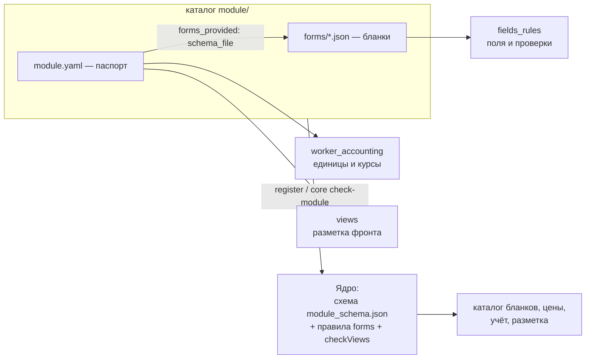

# Паспорт и бланки

**Зачем это.** Подразделение объявляет о себе декларативно — **паспортом** `module.yaml` и файлами
**бланков** `forms/*.json`. Из паспорта ядро знает, какие данные хранить, какую работу продавать и почём, в чём
считать расход и как показать факты. Кода подразделения ядро не видит.

## Из чего состоит



## Паспорт `module.yaml`

Схема — [module_schema.json](https://github.com/vlad78831457/bhendho/blob/v0.3.0/contracts/manifests/module_schema.json).

| Поле | Что | Пример сказок |
|---|---|---|
| `module_id`, `name`, `version` | имя модуля и версия x.y.z | `taleweaver/story-engine`, `0.1.0` |
| `mode` | `worker_service` — отдельный прораб; `in_process` — модуль внутри ядра (только Go) | `worker_service` |
| `worker.runtime`, `worker.target_service` | язык прораба и **код подразделения** — адрес очереди | `python`, `taleweaver` |
| `capabilities` | что нужно: `needs_llm`, `needs_storage_buckets`… — описание, ядро не запускает | — |
| `forms_provided[]` | бланки: см. ниже | 4 бланка |
| `worker_accounting` | `base_unit {name, rate_gc}`, `extra_units[] {name, rate_to_base}`, `max_estimated_base_units` | `tokens` 0,0005 GC; `images` = 8000; `tts_seconds` = 40 |
| `views[]` | разметка фронта: card, section, menu ([10-front](10-front.md)) | «Мои сказки», «Мои герои», «Новая сказка» |
| `events_published` | события прораба | `task.progress` |

### Бланк в `forms_provided`

| Поле | Что |
|---|---|
| `form_id` | имя бланка с версией: `taleweaver.generate_start.v1` |
| `kind` | `fact` — данные, `task` — работа за деньги |
| `title`, `schema_file` | подпись и путь к файлу бланка |
| `base_price_gc` | цена задачи = резерв; меняется в «Тарифах» |
| `result` | только у задачи: `fact_kind`, `versions_field`, `publish` (`auto`/`draft`) — [05-facts](05-facts.md) |
| `audience` | только у факта: `user` (по умолчанию) или слово — память подразделения |
| `user_marks` | только у задачи: `[role, source]` — что положить прорабу о пользователе |

## Файл бланка — `fields_rules`

Пример — продолжение сказки ([generate_continue.json](https://github.com/vlad78831457/orb-tale-servo/blob/main/worker/module/forms/generate_continue.json)):

```json
{
  "title": "Продолжить сказку после выбора",
  "category": "Сказки",
  "fields_rules": {
    "tale": {"type": "fact_ref", "required": true, "expected_fact_kind": "taleweaver.tale.v1"},
    "choice_index": {"type": "int", "min": 0, "max": 5},
    "custom_text": {"type": "text", "max": 500}
  }
}
```

Всё, что кроме `fields_rules`, — подписи для фронта (`meta_ui`); ядро их хранит, но не понимает.

| Тип | Значение | Правила |
|---|---|---|
| `string`, `text` | строка | `required`, `min`, `max` — длина |
| `int`, `float` | число | `min`, `max` |
| `boolean` | да/нет | — |
| `date` | дата | — |
| `select`, `multiselect` | один или несколько вариантов | `options` |
| `fact_ref` | ссылка на **опубликованный** факт пользователя | `expected_fact_kind` |
| `file` | файл пользователя | `allowed_file_types` |
| `list` | список объектов (героев сказки) | `items` — поля элемента; `min`, `max` — число элементов; список в списке нельзя |
| `group` | вложенный объект | `items` — его поля |
| `mix` | свободное значение | — |

Одни и те же правила проверяют три вещи: ввод человека, создание задачи и **результат прораба**. Код —
[forms/forms.go](https://github.com/vlad78831457/bhendho/blob/v0.3.0/internal/core/forms/forms.go).

## Что ядро проверяет при регистрации

1. Паспорт — по JSON-схеме: поля, типы, имена (`ValidateManifestYAML`).
2. Каждый бланк — правила полей корректны (`forms.CheckRules`).
3. Результат:
   - объявлен только у задачи;
   - `versions_field` — это `fact_ref` на тот же вид факта (`checkResult`).
4. Разметка (`checkViews`):
   - `id` уникальны;
   - card и section — на бланк факта этого паспорта;
   - section ссылается на card той же формы;
   - `continue` и меню — на бланк задачи этого паспорта.

Ошибка — `422` с причиной, подразделение не подключается.

## Проверить паспорт до подключения

```sh
core check-module <каталог module/>     # те же проверки, без базы
```

В заготовке это `make check`: она собирает `core` нужной версии ядра (`BHENDHO_REF`) и проверяет паспорт.

## Заготовка нового подразделения

[templates/department/](https://github.com/vlad78831457/bhendho/tree/v0.3.0/templates/department):

| Что | Где |
|---|---|
| паспорт с тремя видами бланков: факт пользователя, задача с резервом и счётом, память подразделения | `module/module.yaml`, `module/forms/` |
| прораб на SDK с подключением по ключу | `worker/src/department/main.py` |
| тест обработчика без ядра | `worker/tests/test_handle.py` |
| `make check`, `make test` в Docker | `Makefile` |
| инструкция для агента | `CLAUDE.md` |

Пошагово — [tale/14-recipes](../tale/14-recipes.md).

## Где в коде

| Файл | Функция | Что |
|---|---|---|
| [modules/modules.go](https://github.com/vlad78831457/bhendho/blob/v0.3.0/internal/core/modules/modules.go) | `Load`, `Parse`, `ParseForm`, `checkResult`, `checkViews` | чтение и проверка паспорта |
| [forms/forms.go](https://github.com/vlad78831457/bhendho/blob/v0.3.0/internal/core/forms/forms.go) | `CheckRules` и проверка значений | правила полей |
| [engine/services.go](https://github.com/vlad78831457/bhendho/blob/v0.3.0/internal/core/engine/services.go) | `RegisterModule` | сервис и бланки в каталог |
| [contracts/manifests/module_schema.json](https://github.com/vlad78831457/bhendho/blob/v0.3.0/contracts/manifests/module_schema.json) | — | схема паспорта |
| [cmd/core/main.go](https://github.com/vlad78831457/bhendho/blob/v0.3.0/cmd/core/main.go) | `check-module` | проверка без базы |
