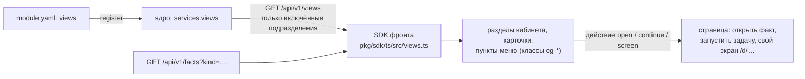

# Фронт: разметка, витрина, панель админа

**Зачем это.** У ядра нет экрана для каждой сферы. Подразделение **описывает** в паспорте, как показать его
факты: карточка, раздел кабинета, пункт меню. Общая оболочка рисует это сама, через SDK фронта, в одном стиле.
Свой экран, как экран сказки, подразделение может иметь отдельно.

## Разметка → экран

| Вид | Что | Обязательные поля |
|---|---|---|
| `card` | как выглядит один факт | `form` (бланк факта), `body` — до 12 элементов |
| `section` | раздел кабинета: список фактов карточками | `form`, `card`, `title`; `order` |
| `menu` | пункт меню | `title`, `target`: бланк задачи, раздел или свой экран `/d/…` |

Элементы карточки берут значения из полей факта **по имени**:
- `title` — заголовок;
- `text` — текст, `lines` — сколько строк показать;
- `image` — картинка;
- `facts` — до 8 полей подписями;
- `badge` — метка;
- `action` — кнопка: `open`, `continue` (запустить задачу с этим фактом), `screen`.

Пример сказок — [module.yaml](https://github.com/vlad78831457/orb-tale-servo/blob/main/worker/module/module.yaml),
раздел `views`: «Мои сказки», «Мои герои», «Новая сказка».

> **Ограничение.** Подписи разметки (`title`, `label`) — одна строка на все языки. На английском экране сказок
> «Мои сказки» остаются по-русски. Решение — подписи по языкам в контракте ядра ([tale/15-gaps](../tale/15-gaps.md)).

## Витрина

Посадочная страница показывает примеры работ. Правила (ADR-74):
- класть на витрину может только админ и только **свои опубликованные** факты, с языком (две буквы) и
  порядком;
- `GET /api/v1/showcase` открыт без входа и отдаёт витрину нужного языка;
- язык по умолчанию — `CORE_SHOWCASE_LANGUAGE`.

## Панель админа `/admin/`

Это фронт ядра ([web/src/pages/Admin.tsx](https://github.com/vlad78831457/bhendho/blob/v0.3.1/web/src/pages/Admin.tsx)).
Пускает только роль `admin`, роль выдаётся на сервере.

| Раздел | Что | Адрес API |
|---|---|---|
| Подразделения | бланки и цены, выключатель, ключи, прорабы и приоритеты, память подразделения, выгрузка базы | `/api/v1/admin/services…`, `/departments/keys`, `/export` |
| Тарифы | цены, курсы единиц, множитель минуса, журнал | `/api/v1/admin/tariffs` |
| Витрина | свои факты на посадочную | `/api/v1/admin/showcase` |
| Настройки | числа ядра, только просмотр, без секретов | `/api/v1/admin/settings` |
| Каталог, Задачи, Данные, Кошелёк | общие страницы по бланкам: любой бланк можно заполнить формой | клиентский API |

**Выгрузка** (ADR-67): `GET /api/v1/admin/export?from=…&to=…` — ZIP. В нём по файлу JSON Lines на таблицу и
`manifest.json`: период, число строк, по какому столбцу отбор. Таблицы берутся из самой базы, новые попадают в
выгрузку сами.

## Где в коде

| Файл | Что |
|---|---|
| [engine/views.go](https://github.com/vlad78831457/bhendho/blob/v0.3.1/internal/core/engine/views.go) | разметка включённых подразделений |
| [modules/modules.go](https://github.com/vlad78831457/bhendho/blob/v0.3.1/internal/core/modules/modules.go) | `View`, `checkViews` — проверка ссылок разметки |
| [pkg/sdk/ts/src/views.ts](https://github.com/vlad78831457/bhendho/blob/v0.3.1/pkg/sdk/ts/src/views.ts) | SDK фронта: типы и отрисовка |
| [engine/showcase.go](https://github.com/vlad78831457/bhendho/blob/v0.3.1/internal/core/engine/showcase.go) | витрина |
| [engine/admin.go](https://github.com/vlad78831457/bhendho/blob/v0.3.1/internal/core/engine/admin.go), [engine/export.go](https://github.com/vlad78831457/bhendho/blob/v0.3.1/internal/core/engine/export.go) | панель, выгрузка |
| [httpapi/admin.go](https://github.com/vlad78831457/bhendho/blob/v0.3.1/internal/core/httpapi/admin.go) | адреса панели, проверка роли |
| [web/src/](https://github.com/vlad78831457/bhendho/tree/v0.3.1/web/src) | фронт ядра (React): `App.tsx` — маршруты `#/…`, `pages/Admin.tsx` |

Как это выглядит — скриншоты панели в `SCREENS.md` снимков `taleweaver-app-vr-ac` и `vr-ad`.
