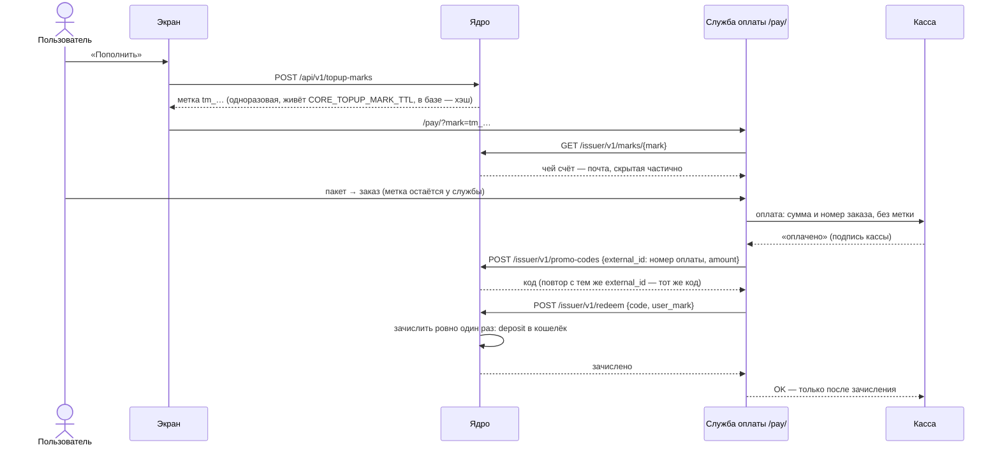

# Оплата в ядре: метки, эмитент, промокоды

**Зачем это.** Ядро не принимает деньги и не знает касс. Деньги принимает **служба оплаты** — отдельное
подразделение со своей кассой, юрлицом и юрисдикцией. Ядро знает только **промокоды**, которые эта служба
выпускает, и зачисляет каждый ровно один раз. Так одно ядро работает с Робокассой, Stripe и чем угодно.

## «Пополнить» — путь денег

Важное:
- **Зачисление по метке, не по email.** У вошедших через VK email может не быть. Метка одноразовая, после
  зачисления больше не работает.
- **Ровно один раз.** Ключ дедупликации — код. Повтор уведомления кассы → тот же `external_id` → тот же код →
  уже погашен → деньги не двоятся.
- **`/issuer/` наружу закрыт** (Caddy отдаёт 404). Служба оплаты ходит в ядро внутри сети. Её токен задаётся
  при запуске ядра: `CORE_PROMO_ISSUERS=имя:токен`.

## Промокоды руками

- **Пользователь вводит код** — `POST /api/v1/promo-codes/redeem`:
  - неверные попытки считаются, после `CORE_PROMO_MAX_FAILURES` за `CORE_PROMO_FAILURE_WINDOW` — пауза;
  - код — 16 символов без похожих букв (`K7PQ-M3XA-9FDE-TW2H`); регистр, пробелы и дефисы не важны.
- **Оператор выпускает подарочные коды** — `core promo-codes --amount 1000 [--email …]`.
- **Отказы** различаются: «нет такого», «уже использован», «истёк». Чужой персональный и отозванный код —
  «нет такого», чтобы не подтверждать, что код существует.
- **Отозвать** можно только непогашенный код. Вернуть деньги покупателю — забота службы оплаты.

## Контракт эмитента

[promo_issuer.openapi.yaml](https://github.com/vlad78831457/bhendho/blob/v0.3.1/contracts/interfaces/promo_issuer.openapi.yaml):

| Адрес | Что |
|---|---|
| `POST /issuer/v1/promo-codes` | выпустить код на сумму (повтор по `external_id` — тот же) |
| `GET /issuer/v1/promo-codes/{id}` | состояние кода |
| `POST /issuer/v1/promo-codes/{id}/revoke` | отозвать непогашенный |
| `GET /issuer/v1/marks/{mark}` | чей счёт под меткой (почта скрыта частично) |
| `POST /issuer/v1/redeem` | зачислить свой код — по метке или по email |

## Где в коде

| Файл | Функция | Что |
|---|---|---|
| [engine/topup.go](https://github.com/vlad78831457/bhendho/blob/v0.3.1/internal/core/engine/topup.go) | — | метки «Пополнить», погашение по метке |
| [engine/promo.go](https://github.com/vlad78831457/bhendho/blob/v0.3.1/internal/core/engine/promo.go) | `IssuePromo`, `RedeemPromo`, `RedeemPromoFor`, `RevokePromo`, `NewPromoCode` | коды и эмитенты |
| [httpapi/promo.go](https://github.com/vlad78831457/bhendho/blob/v0.3.1/internal/core/httpapi/promo.go) | — | адреса эмитента и ввода кода |
| [docs/PROMO.md](https://github.com/vlad78831457/bhendho/blob/v0.3.1/docs/PROMO.md) | — | объяснение промокодов для людей |

Касса со стороны службы оплаты — [tale/11-payments](../tale/11-payments.md).

## Как проверить

- Тесты: [promo_test.go](https://github.com/vlad78831457/bhendho/blob/v0.3.1/internal/core/engine/promo_test.go), [topup_test.go](https://github.com/vlad78831457/bhendho/blob/v0.3.1/internal/core/engine/topup_test.go).
- `make e2e` в `orb-tale-eco`:
  - касса получила OK;
  - на счёте 500 GC;
  - повтор уведомления не зачисляет дважды;
  - `/issuer/` снаружи закрыт.
