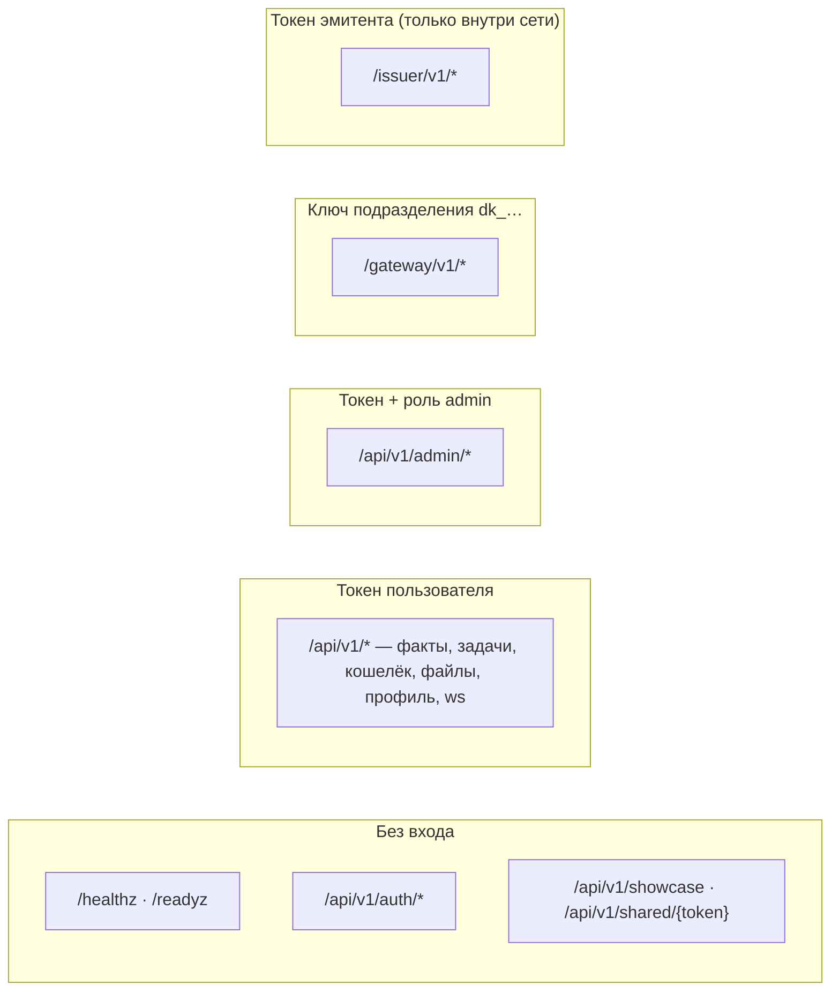

# Карта адресов API

**Зачем это.** Все адреса ядра в одном месте: кто ими пользуется, чем входит, где обработчик. Тела и ответы —
в контрактах и коде обработчиков. Все маршруты регистрируются в
[httpapi/httpapi.go](https://github.com/vlad78831457/bhendho/blob/v0.3.0/internal/core/httpapi/httpapi.go).

## Без входа

| Адрес | Что |
|---|---|
| `GET /healthz` | HTTP отвечает (без базы) |
| `GET /readyz` | готов: база доступна |
| `POST /api/v1/auth/register`, `login`, `refresh`, `logout` | email и пароль, токены |
| `GET /api/v1/auth/providers` | какие внешние входы включены |
| `GET /api/v1/auth/oauth/{provider}/start`, `…/callback`, `POST …/oauth/exchange` | вход через Google, VK ID |
| `GET /api/v1/showcase` | витрина посадочной страницы |
| `GET /api/v1/shared/{token}` | факт по ссылке «поделиться» |
| `GET /api/v1/features` | что включено (например, демо-пополнение) |

## Пользователь

| Группа | Адреса |
|---|---|
| профиль | `GET`/`PATCH /api/v1/me`, `POST /me/password`, `PUT /me/source`, `GET /me/identities`, `POST /me/identities/{provider}/link`, `DELETE /me/identities/{provider}/{subject}` |
| бланки | `GET /api/v1/catalog`, `GET /api/v1/forms/{form_id}`, `GET /api/v1/views` |
| факты | `GET`/`POST /api/v1/facts`, `GET`/`PUT`/`DELETE /facts/{id}`, `POST /facts/{id}/publish` |
| поделиться | `GET`/`POST /api/v1/facts/{id}/shares`, `DELETE /api/v1/shares/{id}`, `POST /api/v1/shared/{token}/copy` |
| задачи | `GET`/`POST /api/v1/tasks`, `GET /tasks/{id}`, `POST /tasks/{id}/commands` (`cancel`, `retry`) |
| деньги | `GET /api/v1/wallets`, `GET /wallets/transactions`, `POST /deposits/demo`, `POST /topup-marks`, `POST /promo-codes/redeem` |
| файлы | `POST /api/v1/files`, `GET`/`DELETE /files/{id}`, `GET /files/{id}/content` |
| события | `GET /api/v1/ws` — WebSocket |

## Админ — [10-front](10-front.md)

`/api/v1/admin/services`, `…/services/{service}` (выключатель), `…/services/{service}/facts`,
`…/services/{service}/prorabs` (приоритеты), `…/departments/keys`, `…/tariffs`, `…/showcase`, `…/settings`,
`…/export`.

## Прораб — [07-gateway](07-gateway.md)

`POST /gateway/v1/register`, `POST /gateway/v1/claim`, `POST /gateway/v1/tasks/{id}/accept`, `…/heartbeat`,
`…/progress`, `…/commit`, `GET /gateway/v1/tasks/{id}/files/{file_id}`.

## Эмитент — [11-pay](11-pay.md)

`POST /issuer/v1/promo-codes`, `GET /issuer/v1/promo-codes/{id}`, `POST /issuer/v1/promo-codes/{id}/revoke`,
`GET /issuer/v1/marks/{mark}`, `POST /issuer/v1/redeem`.

## Где обработчики

| Файл | Что |
|---|---|
| [httpapi.go](https://github.com/vlad78831457/bhendho/blob/v0.3.0/internal/core/httpapi/httpapi.go) | маршруты, проверка токенов, клиентский API, шлюз |
| [admin.go](https://github.com/vlad78831457/bhendho/blob/v0.3.0/internal/core/httpapi/admin.go), [departments.go](https://github.com/vlad78831457/bhendho/blob/v0.3.0/internal/core/httpapi/departments.go) | панель, подразделения |
| [promo.go](https://github.com/vlad78831457/bhendho/blob/v0.3.0/internal/core/httpapi/promo.go) | эмитент и коды |
| [oauth.go](https://github.com/vlad78831457/bhendho/blob/v0.3.0/internal/core/httpapi/oauth.go) | внешний вход |
| [files.go](https://github.com/vlad78831457/bhendho/blob/v0.3.0/internal/core/httpapi/files.go), [shares.go](https://github.com/vlad78831457/bhendho/blob/v0.3.0/internal/core/httpapi/shares.go), [showcase.go](https://github.com/vlad78831457/bhendho/blob/v0.3.0/internal/core/httpapi/showcase.go) | файлы, ссылки, витрина |
