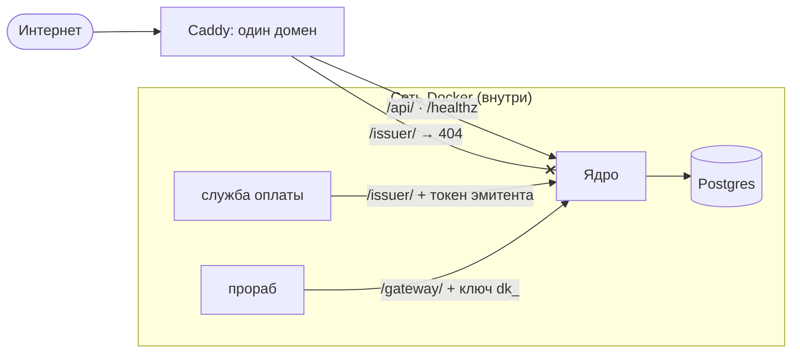

# Безопасность

**Зачем это.** Кто чем входит, что от кого закрыто, где хранятся секреты. Граница одна: ядро не доверяет никому
снаружи и проверяет всё, что приходит, — от пользователя, прораба и службы оплаты.

## Границы доверия

Прораб ходит в ядро внутри сети сборки (`CORE_URL=http://core:8080`). Шлюз проверяет ключ на каждом запросе.

## Кто чем входит

| Кто | Чем | Где хранится | Как отозвать |
|---|---|---|---|
| пользователь | email и пароль (argon2id) или Google / VK ID; короткий access-JWT (`CORE_ACCESS_TTL`) и refresh-токен с ротацией (`CORE_REFRESH_TTL`) | хэш пароля; refresh — хэш, повторное использование старого обнаруживается | выход, смена пароля |
| админ | тот же вход + `role = admin` | `users.role` | `core user-role --role user` |
| прораб | ключ `dk_…` | хэш в `department_keys` и `service_accounts` | повторная выдача ключа на ту же пару заменяет его |
| служба оплаты | токен эмитента из `CORE_PROMO_ISSUERS` | хэш в `promo_issuers` | новый токен при запуске |
| ссылка «поделиться» | `sh_…` | хэш в `shares` | «отозвать» |
| метка «Пополнить» | `tm_…`, одноразовая, со сроком | хэш в `topup_marks` | срок, использование |

Ни один ключ и ни одна ссылка не хранятся в базе открытым текстом — только хэши. Показываются один раз.

## Роли

- `user`, `tester`, `admin` (ADR-61). **Через сайт роль не меняет никто**: `PATCH /api/v1/me` поле `role`
  игнорирует. Только команда на сервере.
- `/api/v1/admin/*` — только `admin`, остальным 403.
- `tester` уходит прорабу в снимке задачи, если бланк просит `user_marks: [role]`. Подразделение решает само,
  что с ним делать.

## Данные пользователя

- **Факты, задачи, кошелёк** — только свои: каждый запрос фильтруется по владельцу.
- **Файлы** (фото героев) лежат в закрытом каталоге `CORE_STORAGE_DIR`. Ядро пересохраняет картинку: поворот,
  без метаданных и геометки, до `CORE_IMAGE_MAX_SIDE`. Показ владельцу — по **подписанной ссылке** с коротким
  сроком (`CORE_FILE_LINK_TTL`). Ключ подписи выводится из секрета ядра, отдельно от ключа JWT. Прораб получает
  только файлы из снимка своей задачи.
- **Память подразделения** пользователю не показывается никогда.
- **Ошибки входа** без подробностей: не раскрывают, есть ли такой аккаунт.
- **Подбор промокода** ограничен.

## Секреты

| Секрет | Где задаётся |
|---|---|
| `JWT_SECRET` | окружение ядра |
| пароль базы | `DATABASE_URL` |
| токены эмитентов | `CORE_PROMO_ISSUERS` |
| ключи OAuth | `CORE_OAUTH_*` |

В сборке сказок всё это — в `deploy/.env` на сервере, файл не в Git. Панель «Настройки» показывает числа ядра
**без секретов**.

## Где в коде

| Файл | Что |
|---|---|
| [auth/auth.go](https://github.com/vlad78831457/bhendho/blob/v0.3.0/internal/core/auth/auth.go) | пароли, токены, ротация |
| [auth/roles.go](https://github.com/vlad78831457/bhendho/blob/v0.3.0/internal/core/auth/roles.go) | роли |
| [auth/oauth_flow.go](https://github.com/vlad78831457/bhendho/blob/v0.3.0/internal/core/auth/oauth_flow.go) | вход через внешние аккаунты |
| [files/sign.go](https://github.com/vlad78831457/bhendho/blob/v0.3.0/internal/core/files/sign.go), [files/image.go](https://github.com/vlad78831457/bhendho/blob/v0.3.0/internal/core/files/image.go) | подписи ссылок, пересохранение картинок |
| [docs/OAUTH.md](https://github.com/vlad78831457/bhendho/blob/v0.3.0/docs/OAUTH.md) | как получить ключи Google и VK ID |
