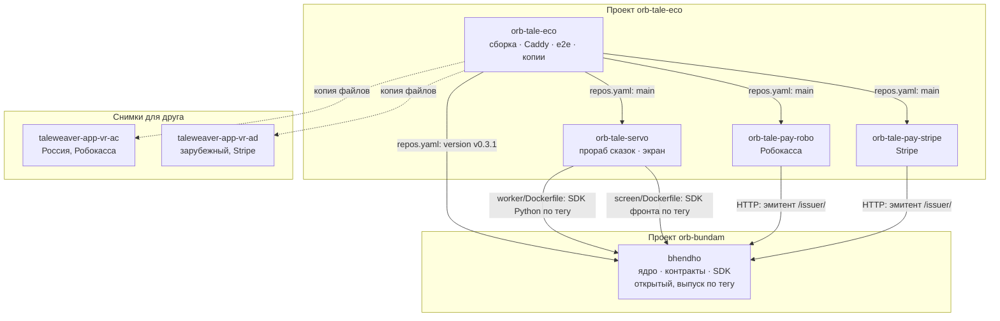

# Карта кода

Все репозитории системы: что где лежит. Ссылки ведут на версии мануала: ядро — тег `v0.3.1`, `orb-tale-*` — `main`.

## Репозитории и зависимости

Ядро не зависит ни от кого. Подразделения зависят от ядра только через **контракты**: паспорт модуля, шлюз
прорабов, эмитент, разметку. Код ядра они не импортируют, кроме SDK, который ядро для них и публикует.

## bhendho — ядро

| Путь | Что здесь |
|---|---|
| [cmd/core/main.go](https://github.com/vlad78831457/bhendho/blob/v0.3.1/cmd/core/main.go) | одна программа `core`: `serve`, `migrate`, `user-role`, `check-module`, `promo-codes`, `healthz` и др. |
| [internal/core/engine/](https://github.com/vlad78831457/bhendho/tree/v0.3.1/internal/core/engine) | **вся логика в транзакциях**: задачи, резервы, факты, шлюз, подразделения, тарифы, оплата |
| [internal/core/httpapi/](https://github.com/vlad78831457/bhendho/tree/v0.3.1/internal/core/httpapi) | адреса HTTP: клиентский API, шлюз прорабов, эмитент, панель админа, вход |
| [internal/core/auth/](https://github.com/vlad78831457/bhendho/tree/v0.3.1/internal/core/auth) | вход: email и пароль (argon2id), токены, роли, OAuth |
| [internal/core/forms/](https://github.com/vlad78831457/bhendho/tree/v0.3.1/internal/core/forms) | проверка полей бланка по `fields_rules` |
| [internal/core/modules/](https://github.com/vlad78831457/bhendho/tree/v0.3.1/internal/core/modules) | чтение паспорта модуля и его бланков, проверка разметки |
| [internal/core/fsm/](https://github.com/vlad78831457/bhendho/tree/v0.3.1/internal/core/fsm) | матрица «статус задачи × команда»: что можно сделать с задачей сейчас |
| [internal/core/money/](https://github.com/vlad78831457/bhendho/tree/v0.3.1/internal/core/money) | бухгалтер: счёт прораба в единицах → GC |
| [internal/core/outbox/](https://github.com/vlad78831457/bhendho/tree/v0.3.1/internal/core/outbox) | доставка событий из очереди `outbox` |
| [internal/core/realtime/](https://github.com/vlad78831457/bhendho/tree/v0.3.1/internal/core/realtime) | WebSocket: события пользователю (прогресс, готово) |
| [internal/core/files/](https://github.com/vlad78831457/bhendho/tree/v0.3.1/internal/core/files) | файлы пользователей: приём картинок, хранилище, подписанные ссылки |
| [internal/core/codes/](https://github.com/vlad78831457/bhendho/tree/v0.3.1/internal/core/codes) | единый реестр кодов отказа |
| [internal/core/config/](https://github.com/vlad78831457/bhendho/tree/v0.3.1/internal/core/config) | все числа ядра из переменных окружения |
| [internal/core/contracts/](https://github.com/vlad78831457/bhendho/tree/v0.3.1/internal/core/contracts) | JSON-схемы контрактов, проверка по ним |
| [internal/core/db/migrations/](https://github.com/vlad78831457/bhendho/tree/v0.3.1/internal/core/db/migrations) | 21 миграция базы, от `0001_core.sql` до `0021_prorab_info.sql` |
| [contracts/interfaces/worker_gateway.openapi.yaml](https://github.com/vlad78831457/bhendho/blob/v0.3.1/contracts/interfaces/worker_gateway.openapi.yaml) | **контракт шлюза прорабов** |
| [contracts/interfaces/promo_issuer.openapi.yaml](https://github.com/vlad78831457/bhendho/blob/v0.3.1/contracts/interfaces/promo_issuer.openapi.yaml) | контракт эмитента: служба оплаты ↔ ядро |
| [contracts/manifests/module_schema.json](https://github.com/vlad78831457/bhendho/blob/v0.3.1/contracts/manifests/module_schema.json) | **схема паспорта модуля** (`module.yaml`) |
| [contracts/manifests/blank_envelope_schema.json](https://github.com/vlad78831457/bhendho/blob/v0.3.1/contracts/manifests/blank_envelope_schema.json) | конверт бланка: что видит фронт и прораб |
| [contracts/events/realtime_events.schema.json](https://github.com/vlad78831457/bhendho/blob/v0.3.1/contracts/events/realtime_events.schema.json) | события WebSocket |
| [pkg/sdk/python/src/offgrid_worker/](https://github.com/vlad78831457/bhendho/tree/v0.3.1/pkg/sdk/python/src/offgrid_worker) | **SDK прораба**: `client.py` — шлюз, `worker.py` — цикл и контекст задачи, `models.py` — типы, `llm.py` — помощь с моделями |
| [pkg/sdk/ts/src/views.ts](https://github.com/vlad78831457/bhendho/blob/v0.3.1/pkg/sdk/ts/src/views.ts) | SDK фронта: рисует разметку подразделения |
| [templates/department/](https://github.com/vlad78831457/bhendho/tree/v0.3.1/templates/department) | **заготовка нового подразделения**: паспорт, бланки, прораб, тесты |
| [web/src/](https://github.com/vlad78831457/bhendho/tree/v0.3.1/web/src) | фронт ядра: панель админа (`pages/Admin.tsx`) и общие страницы по бланкам |
| [docs/specifications/02-decisions.md](https://github.com/vlad78831457/bhendho/blob/v0.3.1/docs/specifications/02-decisions.md) | все решения ADR-01…77 |

### Файлы `engine/` — где какая логика

| Файл | Что |
|---|---|
| [tasks.go](https://github.com/vlad78831457/bhendho/blob/v0.3.1/internal/core/engine/tasks.go) | создание задачи, резерв, команды (отмена, повтор), статусы |
| [gateway.go](https://github.com/vlad78831457/bhendho/blob/v0.3.1/internal/core/engine/gateway.go) | шлюз: выдать задачу прорабу, принять, прогресс, отчёт, списание |
| [prorabs.go](https://github.com/vlad78831457/bhendho/blob/v0.3.1/internal/core/engine/prorabs.go) | уровни и приоритеты прорабов, «кто есть кто» |
| [departments.go](https://github.com/vlad78831457/bhendho/blob/v0.3.1/internal/core/engine/departments.go) | ключи подразделений, регистрация паспорта, выключатель |
| [services.go](https://github.com/vlad78831457/bhendho/blob/v0.3.1/internal/core/engine/services.go) | регистрация сервиса и его бланков в каталоге |
| [templates.go](https://github.com/vlad78831457/bhendho/blob/v0.3.1/internal/core/engine/templates.go) | каталог и шаблоны бланков для фронта |
| [facts.go](https://github.com/vlad78831457/bhendho/blob/v0.3.1/internal/core/engine/facts.go) | факты и версии: создать, опубликовать, удалить |
| [resultfact.go](https://github.com/vlad78831457/bhendho/blob/v0.3.1/internal/core/engine/resultfact.go) | результат задачи → факт или новая версия факта |
| [servicefacts.go](https://github.com/vlad78831457/bhendho/blob/v0.3.1/internal/core/engine/servicefacts.go) | память подразделения: факты от прораба |
| [wallets.go](https://github.com/vlad78831457/bhendho/blob/v0.3.1/internal/core/engine/wallets.go) | кошельки, проводки, демо-пополнение |
| [tariffs.go](https://github.com/vlad78831457/bhendho/blob/v0.3.1/internal/core/engine/tariffs.go) | цены бланков, курсы единиц, множитель минуса |
| [topup.go](https://github.com/vlad78831457/bhendho/blob/v0.3.1/internal/core/engine/topup.go) | метки «Пополнить» |
| [promo.go](https://github.com/vlad78831457/bhendho/blob/v0.3.1/internal/core/engine/promo.go) | промокоды и эмитенты |
| [shares.go](https://github.com/vlad78831457/bhendho/blob/v0.3.1/internal/core/engine/shares.go) | ссылки «поделиться» и копии |
| [views.go](https://github.com/vlad78831457/bhendho/blob/v0.3.1/internal/core/engine/views.go), [showcase.go](https://github.com/vlad78831457/bhendho/blob/v0.3.1/internal/core/engine/showcase.go) | разметка фронта, витрина |
| [admin.go](https://github.com/vlad78831457/bhendho/blob/v0.3.1/internal/core/engine/admin.go), [export.go](https://github.com/vlad78831457/bhendho/blob/v0.3.1/internal/core/engine/export.go) | панель админа, выгрузка базы |
| [sweeper.go](https://github.com/vlad78831457/bhendho/blob/v0.3.1/internal/core/engine/sweeper.go) | уборщик: истёкшие блокировки задач |
| [files.go](https://github.com/vlad78831457/bhendho/blob/v0.3.1/internal/core/engine/files.go) | реестр файлов пользователей |

## orb-tale-servo — подразделение сказок

| Путь | Что здесь |
|---|---|
| [worker/module/module.yaml](https://github.com/vlad78831457/orb-tale-servo/blob/main/worker/module/module.yaml) | **паспорт подразделения**: бланки, учёт в единицах, разметка кабинета |
| [worker/module/forms/](https://github.com/vlad78831457/orb-tale-servo/tree/main/worker/module/forms) | бланки: `character` (герой), `tale` (сказка), `generate_start`, `generate_continue` |
| [worker/src/taleweaver_worker/main.py](https://github.com/vlad78831457/orb-tale-servo/blob/main/worker/src/taleweaver_worker/main.py) | **вход прораба**: подключение к ядру, ETA, обработчик задачи |
| [worker/src/taleweaver_worker/pipeline.py](https://github.com/vlad78831457/orb-tale-servo/blob/main/worker/src/taleweaver_worker/pipeline.py) | конвейер: старт и продолжение, сегмент, медиа страниц |
| [worker/src/taleweaver_worker/story.py](https://github.com/vlad78831457/orb-tale-servo/blob/main/worker/src/taleweaver_worker/story.py) | сюжет: промпты, разбор ответа модели, счётчик единиц `Meter` |
| [worker/src/taleweaver_worker/providers/](https://github.com/vlad78831457/orb-tale-servo/tree/main/worker/src/taleweaver_worker/providers) | **провайдеры — выход во внешние API**: `yandex.py`, `proxyapi.py`, `sber.py`, `smart.py`, заглушки `stub.py`, протоколы `base.py`, выбор по языку `__init__.py` |
| [worker/src/taleweaver_worker/audio.py](https://github.com/vlad78831457/orb-tale-servo/blob/main/worker/src/taleweaver_worker/audio.py), [voices.py](https://github.com/vlad78831457/orb-tale-servo/blob/main/worker/src/taleweaver_worker/voices.py) | озвучка: голоса персонажей, звуки, музыка → mp3 страницы |
| [worker/src/taleweaver_worker/markup.py](https://github.com/vlad78831457/orb-tale-servo/blob/main/worker/src/taleweaver_worker/markup.py), [media.py](https://github.com/vlad78831457/orb-tale-servo/blob/main/worker/src/taleweaver_worker/media.py) | разметка текста (`[[Имя]]`, звуки), хранилище картинок и аудио |
| [worker/src/taleweaver_worker/config.py](https://github.com/vlad78831457/orb-tale-servo/blob/main/worker/src/taleweaver_worker/config.py) | настройки из окружения, уровни `TIER` |
| [worker/tests/](https://github.com/vlad78831457/orb-tale-servo/tree/main/worker/tests) | тесты конвейера и уровней; `e2e` — сказка через ядро; `live` — настоящие модели |
| [worker/Dockerfile](https://github.com/vlad78831457/orb-tale-servo/blob/main/worker/Dockerfile) | образ прораба; SDK ядра по тегу `BHENDHO_SDK_REF` |
| [screen/src/tale/](https://github.com/vlad78831457/orb-tale-servo/tree/main/screen/src/tale) | экран сказки: `backend.ts` — связь с ядром, `mapping.ts` — экран ↔ бланки, `cabinet.ts`, `auth.ts`, `share.ts`, `i18n/` |
| [screen/src/lib/](https://github.com/vlad78831457/orb-tale-servo/tree/main/screen/src/lib) | клиент API ядра, realtime, локальная база |

## orb-tale-pay-robo и orb-tale-pay-stripe — оплата

| Путь | Что здесь |
|---|---|
| [orb-tale-pay-robo/server.go](https://github.com/vlad78831457/orb-tale-pay-robo/blob/main/server.go) | страницы `/pay/`: пакеты, заказ, уведомление кассы |
| [orb-tale-pay-robo/robokassa.go](https://github.com/vlad78831457/orb-tale-pay-robo/blob/main/robokassa.go) | подпись запроса и проверка уведомления Робокассы |
| [orb-tale-pay-robo/core.go](https://github.com/vlad78831457/orb-tale-pay-robo/blob/main/core.go) | вызовы эмитента ядра: выпустить код, зачислить по метке |
| [orb-tale-pay-robo/store.go](https://github.com/vlad78831457/orb-tale-pay-robo/blob/main/store.go) | заказы — файл на заказ, атомарная запись |
| [orb-tale-pay-stripe/stripe.go](https://github.com/vlad78831457/orb-tale-pay-stripe/blob/main/stripe.go) | Stripe Checkout и проверка подписи вебхука |
| [orb-tale-pay-stripe/server.go](https://github.com/vlad78831457/orb-tale-pay-stripe/blob/main/server.go) | страницы `/pay/` по-английски, заказ, вебхук |

## orb-tale-eco — сборка

| Путь | Что здесь |
|---|---|
| [repos.yaml](https://github.com/vlad78831457/orb-tale-eco/blob/main/repos.yaml) | из чего собирается система, с версиями |
| [deploy/compose.yaml](https://github.com/vlad78831457/orb-tale-eco/blob/main/deploy/compose.yaml) | все службы одной командой |
| [deploy/compose.stripe.yaml](https://github.com/vlad78831457/orb-tale-eco/blob/main/deploy/compose.stripe.yaml) | зарубежный контур: Stripe вместо Робокассы |
| [deploy/Caddyfile](https://github.com/vlad78831457/orb-tale-eco/blob/main/deploy/Caddyfile) | один домен: какой адрес куда идёт |
| [deploy/backup/](https://github.com/vlad78831457/orb-tale-eco/tree/main/deploy/backup) | копии базы и медиа, подъём с копии |
| [e2e/](https://github.com/vlad78831457/orb-tale-eco/tree/main/e2e) | сквозная проверка, поддельный Stripe |
| [shots/](https://github.com/vlad78831457/orb-tale-eco/tree/main/shots) | скриншоты безголовым браузером |
| [Makefile](https://github.com/vlad78831457/orb-tale-eco/blob/main/Makefile) | `make up`, `e2e`, `backup`, `shots`, `PAY=stripe` |
