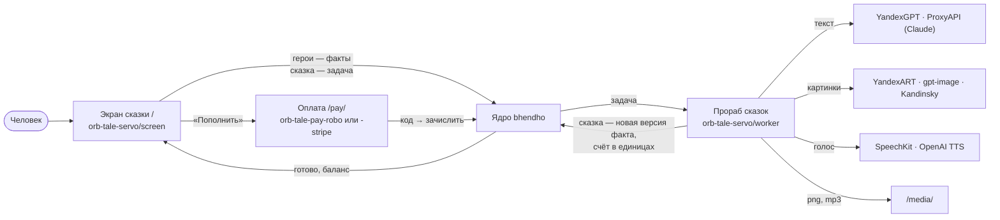

# Система сказок: обзор

**Зачем это.** Taleweaver пишет детям интерактивные сказки с картинками и озвучкой. Это первая сфера услуг на
ядре `bhendho`. На ней видно, как подразделение живёт рядом с ядром.

## Что видит человек и что за этим стоит

1. **Человек создаёт героя.** Это факт `taleweaver.character.v1` пользователя.
2. **Нажимает «Соткать сказку».** Экран создаёт задачу `taleweaver.generate_start.v1`, ядро резервирует 150 GC.
3. **Прораб сказок берёт задачу.** Сюжет до развилки пишет модель текста, страницы рисует модель картинок,
   голоса озвучивает модель речи.
4. **Сказка возвращается фактом** `taleweaver.tale.v1`, версия 1. Ядро списывает по факту и возвращает остаток.
5. **Человек выбирает продолжение.** Это задача `generate_continue` в группе сказки. Каждое продолжение — новая
   версия того же факта.
6. **Денег не хватает → «Пополнить».** Служба оплаты, касса, промокод, зачисление по метке.

## Два контура

Юридические контуры независимы (директор, 2026-10-15). Это разные развёртывания со своими кассами:

| | Россия | Зарубежный |
|---|---|---|
| касса | Робокасса, рубли | Stripe, доллары |
| подразделение оплаты | `orb-tale-pay-robo` | `orb-tale-pay-stripe`, страницы по-английски |
| запуск | `make up` | `make up PAY=stripe` |
| снимок для друга | `taleweaver-app-vr-ac` | `taleweaver-app-vr-ad` |

Ядро, прораб сказок и экран у обоих одни и те же.

## Главы

| Для кого | Читать |
|---|---|
| разработчик воркера | [паспорт](03-department.md) → [устройство воркера](04-worker-map.md) → [путь сказки через код](05-task-path.md) → [конвейер](06-pipeline.md) → [провайдеры](07-providers.md) → [озвучка](08-audio.md) → [счёт](09-accounting.md) |
| аналитик | этот обзор → [репозитории](01-repos.md) → [развёртывание](02-deploy.md) → [путь сказки](05-task-path.md) |
