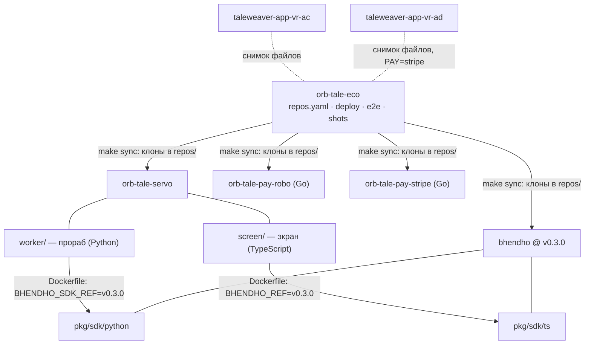

# Репозитории и версии

**Зачем это.** Система сказок собирается из пяти репозиториев. Здесь видно, что откуда берётся и по какой
версии. Полный список файлов — [карта кода](../map.md).

| Репозиторий | Язык | Что | Проверка |
|---|---|---|---|
| [orb-tale-eco](https://github.com/vlad78831457/orb-tale-eco/blob/main/repos.yaml) | compose, sh, Python (e2e) | сборка всей системы, один домен, копии, сквозная проверка | `make test`, `make e2e` |
| [orb-tale-servo](https://github.com/vlad78831457/orb-tale-servo/tree/main/worker) | Python, TypeScript | прораб сказок и экран | `make test`: ruff, mypy, pytest; tsc, vitest |
| [orb-tale-pay-robo](https://github.com/vlad78831457/orb-tale-pay-robo/blob/main/main.go) | Go, только стандартная библиотека | оплата Робокассой | `make test` |
| [orb-tale-pay-stripe](https://github.com/vlad78831457/orb-tale-pay-stripe/blob/main/main.go) | Go, только стандартная библиотека | оплата Stripe | `make test` |
| [bhendho](https://github.com/vlad78831457/bhendho/tree/v0.3.0) | Go, Python и TS SDK | ядро — [часть «Ядро»](../bhendho/README.md) | `make test` |

## Версии

- **Ядро — по тегу.** Тег записан в трёх местах:
  - [repos.yaml](https://github.com/vlad78831457/orb-tale-eco/blob/main/repos.yaml) (`version: v0.3.0`);
  - [worker/Dockerfile](https://github.com/vlad78831457/orb-tale-servo/blob/main/worker/Dockerfile) (`BHENDHO_SDK_REF`);
  - [screen/Dockerfile](https://github.com/vlad78831457/orb-tale-servo/blob/main/screen/Dockerfile) (`BHENDHO_REF`).

  Код ядра в подразделения не копируется.
- **Подразделения — `main`.** Ветки — общая последовательность проекта `orb-tale-eco`; следующий свободный
  индекс — `make next-index`.
- **Снимки для друга** — копия файлов `orb-tale-*` на дату. Подразделения лежат там папками, ядро — по тегу.
  Работа идёт в `orb-tale-*`, снимок переснимается.
