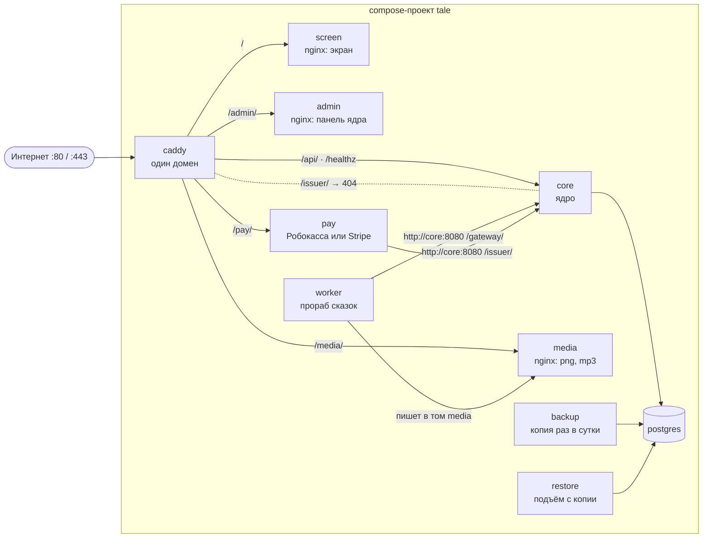
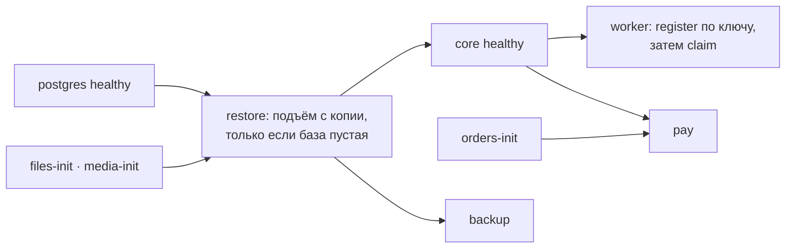

# Развёртывание

**Зачем это.** Вся система поднимается одной командой: службы Docker на одном домене за Caddy. Здесь видно,
какие службы есть, кто с кем говорит и что открыто наружу.

Файлы:
- [deploy/compose.yaml](https://github.com/vlad78831457/orb-tale-eco/blob/main/deploy/compose.yaml);
- [deploy/compose.stripe.yaml](https://github.com/vlad78831457/orb-tale-eco/blob/main/deploy/compose.stripe.yaml);
- [deploy/Caddyfile](https://github.com/vlad78831457/orb-tale-eco/blob/main/deploy/Caddyfile).

## Службы

| Служба | Образ / сборка | Том | Зачем |
|---|---|---|---|
| `postgres` | `postgres:17-alpine` | `pgdata` | база ядра |
| `core` | `repos/bhendho`, цель `runtime` | `files` | ядро; здоровье — `/core healthz` |
| `worker` | `repos/orb-tale-servo/worker` | `media`, tmpfs `/tmp` | прораб сказок; ждёт здоровое ядро |
| `screen` | `repos/orb-tale-servo/screen` | — | экран сказки |
| `admin` | фронт ядра `repos/bhendho/web` | — | панель админа |
| `pay` | `repos/orb-tale-pay-robo`, или `-stripe` при `PAY=stripe` | `orders` | оплата; заказы — файлами |
| `media` | `nginx:1.27-alpine` | `media` (только чтение) | раздача картинок и озвучки |
| `caddy` | `caddy:2.8-alpine` | `caddy-data`, `caddy-config` | вход, сертификаты своего домена |
| `backup`, `restore` | `postgres:17-alpine` | `BACKUP_DIR` | копии и подъём ([12-operations](12-operations.md)) |
| `files-init`, `media-init`, `orders-init` | `busybox` | — | права на тома до старта служб |

## Порядок старта

## Настройки — `deploy/.env`

Файл создаёт `make init-env` со случайными секретами. В Git он не попадает.

| Переменная | Что |
|---|---|
| `POSTGRES_PASSWORD`, `JWT_SECRET`, `PAY_ISSUER_TOKEN` | секреты; токен эмитента — общий для ядра и `pay` |
| `TALE_DEPARTMENT_KEY` | ключ подразделения из панели; без него прораб не подключится |
| `TALE_TIER`, `PROVIDERS` | уровень прораба ([07-providers](07-providers.md)) |
| `YANDEX_API_KEY`, `YANDEX_FOLDER_ID`, `PROXY_API_KEY` | ключи моделей для живых уровней |
| `PRORAB_TITLE`, `PRORAB_DESCRIPTION` | как прораба увидит админ |
| `ROBOKASSA_*`, `PAY_PACKAGES` | Робокасса |
| `STRIPE_*`, `STRIPE_PACKAGES` | Stripe при `PAY=stripe` |
| `SITE_ADDRESS`, `HTTP_PORT`, `HTTPS_PORT`, `PUBLIC_URL` | домен и порты |
| `CORE_DEMO_DEPOSIT` | демо-пополнение для проверки |
| `BACKUP_DIR`, `BACKUP_KEEP_DAYS`, `BACKUP_INTERVAL` | копии |

## Где в коде

| Файл | Что |
|---|---|
| [deploy/compose.yaml](https://github.com/vlad78831457/orb-tale-eco/blob/main/deploy/compose.yaml) | службы, тома, переменные, здоровье |
| [deploy/compose.stripe.yaml](https://github.com/vlad78831457/orb-tale-eco/blob/main/deploy/compose.stripe.yaml) | замена `pay` на Stripe и поддельный Stripe для e2e |
| [deploy/Caddyfile](https://github.com/vlad78831457/orb-tale-eco/blob/main/deploy/Caddyfile) | маршруты одного домена |
| [Makefile](https://github.com/vlad78831457/orb-tale-eco/blob/main/Makefile) | `init-env`, `up`, `down`, `backup`, `e2e`, `shots`, `PAY` |
