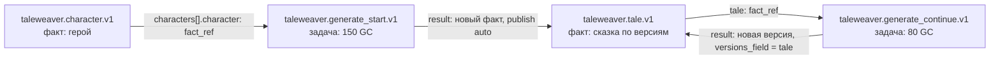

# Паспорт сказок

**Зачем это.** Паспорт — всё, что подразделение сказок объявляет ядру:
- какие данные хранит — героев и сказки;
- какую работу продаёт — начать и продолжить;
- в чём считает расход;
- как показать в кабинете.

Код прораба опирается на эти имена полей. Меняя паспорт, меняешь контракт с экраном и ядром.

Файлы:
- [worker/module/module.yaml](https://github.com/vlad78831457/orb-tale-servo/blob/main/worker/module/module.yaml);
- [worker/module/forms/](https://github.com/vlad78831457/orb-tale-servo/tree/main/worker/module/forms).

Общие правила паспорта — [bhendho/09-passport-and-blanks](../bhendho/09-passport-and-blanks.md).

## Четыре бланка



### `taleweaver.character.v1` — герой (факт)

| Поле | Тип | Что |
|---|---|---|
| `name` | string 1–100, обязательно | имя |
| `role` | select: `hero`, `companion`, `antagonist` | роль в сказке |
| `description` | text ≤500 | характер и внешность — уходит в промпт |
| `photo` | file jpeg/png | фото героя — опорная картинка для иллюстраций |

### `taleweaver.generate_start.v1` — начать сказку (задача, 150 GC)

| Поле | Что |
|---|---|
| `characters[]` | до 6 героев, каждый — `fact_ref` на **опубликованного** героя |
| `mode` | `narrative` — сказка целиком; `interactive` — до развилки, дальше выбор |
| `language` | `ru`, `en` — **по нему выбираются модели** ([07-providers](07-providers.md)) |
| `media` | `text`, `images`, `audio`, `animations` |
| `length` | `super_short` … `long` — число страниц в режиме `narrative` |
| `image_mode` | `ai` — модель рисует; `procedural` — без модели картинок |
| `voice`, `bg_sounds`, `bg_music` | голос рассказчика, звуки, музыка |
| `age`, `gender`, `atmosphere`, `setting_time`, `setting_location`, `theme`, `wishes`, `image_style`, `allow_puzzles`, `add_reflection_questions` | пожелания для сюжета и стиля |

Результат: `{fact_kind: taleweaver.tale.v1, publish: auto}` — новый факт-сказка, версия 1 сразу
опубликована.

### `taleweaver.generate_continue.v1` — продолжить (задача, 80 GC)

| Поле | Что |
|---|---|
| `tale` | `fact_ref` на сказку, обязательно |
| `choice_index` | 0–5 — один из вариантов развилки |
| `custom_text` | ≤500 — свой вариант |

Нужно ровно одно из двух. Иначе прораб отвечает `DATA_REJECTED`.

Результат: `{versions_field: tale, publish: auto}` — новая версия **той же** сказки. Экран ставит продолжения в
**группу** `group_id = id сказки`: два продолжения не перетрут друг друга, а идут по очереди.

### `taleweaver.tale.v1` — сказка (факт, пишет прораб)

| Поле | Что |
|---|---|
| `tale_key`, `title`, `language` | ключ, название, язык |
| `status` | `awaiting_choice` — ждёт выбора; `complete` — закончена |
| `preferences` | пожелания из бланка старта — нужны продолжениям |
| `style_bible`, `reference_image` | стиль картинок и опорная картинка — для единого стиля всех сегментов |
| `voice_map` | какой персонаж каким голосом — закреплено на всю сказку |
| `pages[]` | страницы: `page_index`, `kind` (`narrative`, `choice`, `puzzle`, `reflection`), `text` с разметкой, `plain_text` для чтения, `image_url`, `audio_url`, `duration_ms`, `extra` (варианты выбора, загадка) |

## Учёт

```yaml
worker_accounting:
  base_unit: {name: tokens, rate_gc: 0.0005}
  extra_units:
    - {name: images, rate_to_base: 8000}      # картинка = 8000 токенов = 4 GC
    - {name: tts_seconds, rate_to_base: 40}   # секунда озвучки = 40 токенов = 0,02 GC
```

Как прораб считает — [09-accounting](09-accounting.md).

## Разметка кабинета

| `id` | Вид | Что |
|---|---|---|
| `tale.card` | card | заголовок, язык, кнопка «Читать» |
| `tale.section` | section | «Мои сказки», новые сверху |
| `hero.card` | card | фото, имя, роль |
| `hero.section` | section | «Мои герои» |
| `tale.new` | menu | «Новая сказка» → бланк старта |

Подписи на одном языке — см. [15-gaps](15-gaps.md).
