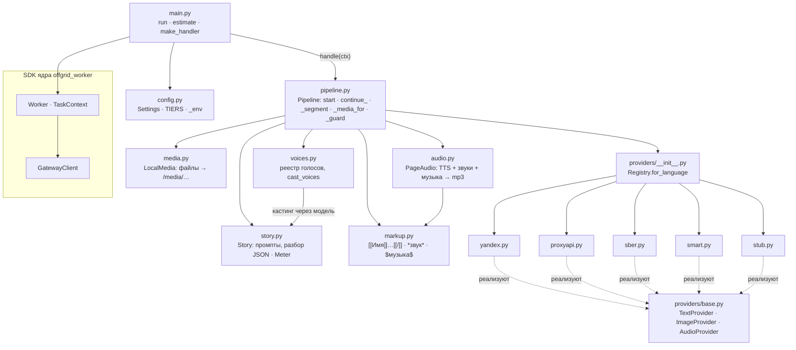

# Устройство воркера

**Зачем это.** Воркер сказок — одна программа на Python. В ней:
- **прораб** — цикл работы с ядром, даёт SDK;
- **конвейер** — как из бланка получается сказка;
- **провайдеры** — вызовы внешних моделей.

Здесь видно, какой модуль за что отвечает и кто кого вызывает.

Код — [worker/src/taleweaver_worker/](https://github.com/vlad78831457/orb-tale-servo/tree/main/worker/src/taleweaver_worker).

## Модули

| Модуль | Отвечает за | Главное |
|---|---|---|
| [main.py](https://github.com/vlad78831457/orb-tale-servo/blob/main/worker/src/taleweaver_worker/main.py) | вход: проверить уровень, подключиться по ключу, запустить цикл | `run`, `estimate`, `make_handler` |
| [config.py](https://github.com/vlad78831457/orb-tale-servo/blob/main/worker/src/taleweaver_worker/config.py) | все настройки из окружения; уровни `TIER` | `Settings.from_env`, `TIERS`, `_env`, `tier_problem` |
| [pipeline.py](https://github.com/vlad78831457/orb-tale-servo/blob/main/worker/src/taleweaver_worker/pipeline.py) | сегмент сказки: сюжет → голоса → страницы → медиа | `Pipeline.start`, `continue_`, `_segment`, `_media_for`, `_guard`, `SegmentError` |
| [story.py](https://github.com/vlad78831457/orb-tale-servo/blob/main/worker/src/taleweaver_worker/story.py) | промпты сюжета и разбор ответа модели; счётчик | `Story.full`, `start`, `continuation`, `style_bible`, `image_prompt`; `Meter`; `StoryError` |
| [voices.py](https://github.com/vlad78831457/orb-tale-servo/blob/main/worker/src/taleweaver_worker/voices.py) | голоса провайдеров; кто из персонажей каким голосом | `VOICE_REGISTRY`, `cast_voices` |
| [audio.py](https://github.com/vlad78831457/orb-tale-servo/blob/main/worker/src/taleweaver_worker/audio.py) | озвучка страницы в один mp3 | `PageAudio.build` |
| [markup.py](https://github.com/vlad78831457/orb-tale-servo/blob/main/worker/src/taleweaver_worker/markup.py) | разметка текста страницы | `parse_page_text`, `plain_text`, `extract_speaker_names` |
| [media.py](https://github.com/vlad78831457/orb-tale-servo/blob/main/worker/src/taleweaver_worker/media.py) | сохранить png и mp3, отдать адрес | `LocalMedia` |
| [providers/](https://github.com/vlad78831457/orb-tale-servo/tree/main/worker/src/taleweaver_worker/providers) | **выход во внешние API** | [07-providers](07-providers.md) |

## Как воркер запускается

`main.run()`:
1. `tier_problem()`: неизвестный `TIER` — сразу ошибка, без тихого отката на заглушки.
2. `Settings.from_env()`. Без `WORKER_TOKEN` (ключа подразделения) — выход. Нехватку ключей моделей пишет в
   лог: `provider config: …`.
3. Собрать `Pipeline` из настроек, `Registry` провайдеров и `LocalMedia`.
4. `GatewayClient(CORE_URL, WORKER_TOKEN)`. Если задан `MODULE_DIR` — `client.register(...)`: паспорт и бланки в
   ядро, подпись и описание уровня.
5. `Worker(...)`: подразделение `taleweaver`, версии бланков `SCHEMA_VERSIONS` (по умолчанию `1`),
   `WORKER_CONCURRENCY` слотов (2), обработчик `make_handler(pipeline)`, оценка `estimate`.
6. `SIGTERM` → `worker.stop()`: текущие сказки доделываются.

## Обработчик — переход от SDK к конвейеру

`make_handler(pipeline)` возвращает `handle(ctx)`:

| Бланк | Что зовёт |
|---|---|
| `generate_start` | берёт фото героев байтами через шлюз (`ctx.file`), затем `pipeline.start(...)` |
| `generate_continue` | `pipeline.continue_(...)` |
| другой | `TaskError("unsupported form")` |

Ошибки переводятся в язык ядра:

| Исключение конвейера | → SDK | Вердикт |
|---|---|---|
| `SegmentError`: сказка завершена, неверный выбор | `DataRejected` | `DATA_REJECTED` — повтора нет |
| `StoryError`: модель ответила не по формату | `TaskError` | `WORKER_ERROR` — повтор имеет смысл |
| сбой сети, таймаут, прочее | исключение как есть | `WORKER_ERROR` |

В конце — счёт: `ctx.charge("tokens" | "images" | "tts_seconds", …)` из `Meter`. Затем `Outcome(result=сказка,
report={"segment": …})`.

## ETA — `estimate`

Ядро ждёт отчёт **3 × ETA**, и сердцебиение этот срок не продлевает. Поэтому оценка — по настоящим моделям:
- 40 с на текст;
- за каждую страницу 30 с, если рисуем, и 15 с, если озвучиваем;
- страниц 4 в интерактивном режиме, иначе по длине: 4, 6, 12 или 20.

## Тесты

| Где | Что |
|---|---|
| [tests/test_pipeline.py](https://github.com/vlad78831457/orb-tale-servo/blob/main/worker/tests/test_pipeline.py) | конвейер на заглушках |
| [tests/test_tiers.py](https://github.com/vlad78831457/orb-tale-servo/blob/main/worker/tests/test_tiers.py) | уровни и переменные |
| [tests/e2e/](https://github.com/vlad78831457/orb-tale-servo/tree/main/worker/tests/e2e) | сказка целиком через настоящее ядро |
| [tests/live/](https://github.com/vlad78831457/orb-tale-servo/tree/main/worker/tests/live) | настоящие модели, ключи — из окружения |
