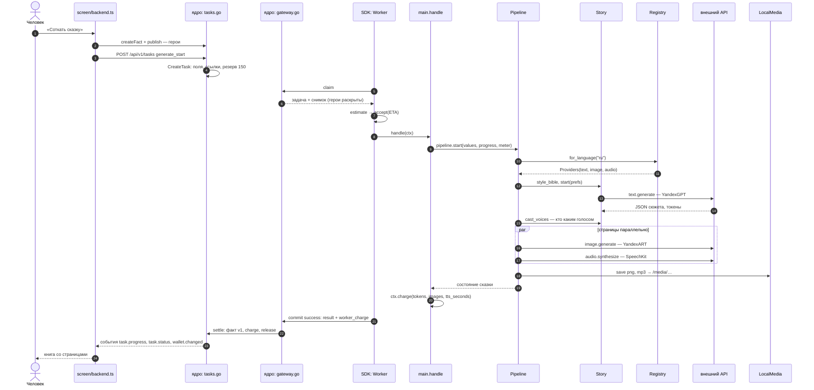
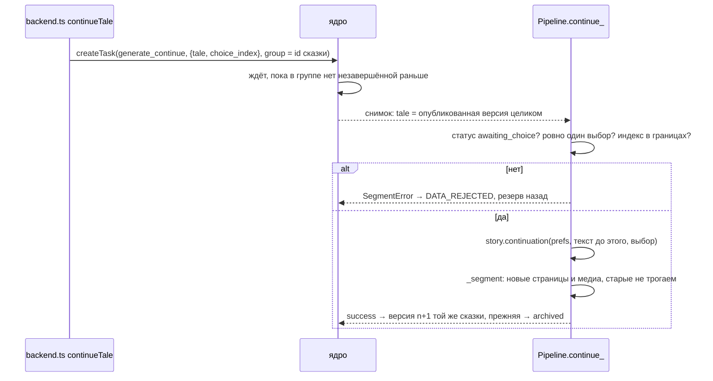

# Путь одной сказки через код

**Зачем это.** Одна сказка проходит через всю систему: от кнопки «Соткать сказку» до вызова внешней модели и
обратно на экран. Здесь путь расписан по шагам. На каждом шаге — **файл и функция**, чтобы пройти его в коде
самому.

## Схема целиком

## По шагам

### 1. Экран: герои и задача

| Шаг | Где | Что |
|---|---|---|
| герои | [screen/src/tale/backend.ts](https://github.com/vlad78831457/orb-tale-servo/blob/main/screen/src/tale/backend.ts) `createHeroes` | каждый герой — `createFact(taleweaver.character.v1)` и публикация: задача примет только опубликованных |
| хватит ли денег | там же, `ensureFunds` | цена бланка против `available`; не хватает — предложить «Пополнить» |
| состояние экрана → бланк | [screen/src/tale/mapping.ts](https://github.com/vlad78831457/orb-tale-servo/blob/main/screen/src/tale/mapping.ts) | настройки «стола сказочника» → `values` бланка |
| задача | `backend.ts` `startTale` → `api.createTask(START_FORM, values, uuid())` | ключ идемпотентности — новый `uuid` |
| прогресс | `backend.ts` — подписка на события | `task.progress` → полоса прогресса, `task.status` → готово |

### 2. Ядро: принять задачу

[engine/tasks.go](https://github.com/vlad78831457/bhendho/blob/v0.3.1/internal/core/engine/tasks.go) `CreateTask`:
1. поля по `fields_rules`;
2. герои опубликованы;
3. резерв 150 GC;
4. `pending`.

Подробно — [bhendho/06-tasks](../bhendho/06-tasks.md).

### 3. Прораб: взять задачу

| Шаг | Где |
|---|---|
| опрос очереди | SDK [worker.py](https://github.com/vlad78831457/bhendho/blob/v0.3.1/pkg/sdk/python/src/offgrid_worker/worker.py) `Worker.run_once` → `GatewayClient.claim` |
| выбор прораба и снимок | ядро [gateway.go](https://github.com/vlad78831457/bhendho/blob/v0.3.1/internal/core/engine/gateway.go) `Claim`, `materialize` |
| оценка | [main.py](https://github.com/vlad78831457/orb-tale-servo/blob/main/worker/src/taleweaver_worker/main.py) `estimate` → `accept(eta)` |
| обработчик | `main.py` `make_handler` → `handle(ctx)` → фото героев `ctx.file` → `Pipeline.start` |

### 4. Конвейер: сюжет

[pipeline.py](https://github.com/vlad78831457/orb-tale-servo/blob/main/worker/src/taleweaver_worker/pipeline.py) `Pipeline.start`:
1. `preferences_from(values)` — пожелания из бланка;
2. `registry.for_language(language)` — какие провайдеры для этого языка;
3. `progress(5, "plot")`;
4. `story.style_bible(prefs)` — если нужны картинки;
5. `story.full(prefs)` или `story.start(prefs)` — сюжет целиком или до развилки.

[story.py](https://github.com/vlad78831457/orb-tale-servo/blob/main/worker/src/taleweaver_worker/story.py)
`Story._chat`:
- зовёт `text.generate(system, user, max_tokens)` — **первый выход во внешний API**;
- прибавляет `meter.tokens`;
- `extract_json` разбирает ответ. Не JSON — `StoryError` → повтор задачи.

### 5. Конвейер: страницы и медиа

`Pipeline._segment`:
1. `cast_voices` — модель назначает персонажам голоса из реестра провайдера озвучки, `progress(20, "voice_casting")`;
2. страницы `_page(...)`: `text` с разметкой и `plain_text`, `progress(30, "text_ready")`;
3. `_media_for` — картинки и озвучка.

`Pipeline._media_for`:
- **опорная картинка.** Если в сказке её ещё нет, первая страница рисуется отдельно. Её картинка — образец
  стиля для остальных и для будущих продолжений. Фото героев идут образцами в каждую картинку;
- **картинка страницы:** `story.image_prompt(...)` (модель текста пишет промпт) → `image.generate(prompt, refs)`
  — **внешний API картинок** → `media.save` → `image_url`;
- **озвучка страницы:** `PageAudio.build(...)` → `audio.synthesize` по репликам — **внешний API речи** →
  сборка mp3 → `audio_url`;
- каждая страница — в `_guard`: место в очереди (семафор), затем таймаут и перехват. Одна упавшая страница
  остаётся без картинки или звука, но не валит сказку;
- прогресс `30 + 65 × готово/всего`, фаза `media k/n`.

### 6. Отчёт и деньги

| Шаг | Где |
|---|---|
| счёт | `main.handle`: `ctx.charge("tokens", meter.tokens)`, `images`, `tts_seconds` |
| результат | `Outcome(result=state, report={"segment": …})` |
| сдача | SDK `commit_success(result, charge, report)` |
| засчитать | ядро `Commit` → `settle`: проверить сказку по бланку `tale`, факт v1 `published`, списание и возврат |
| показать | `outbox` → `realtime` → `backend.ts` → `loadTale` |

## Продолжение

## Как пройти путь руками

- `make e2e` в `orb-tale-eco`: от регистрации и оплаты до сказки и «поделиться».
- [test_tale_e2e.py](https://github.com/vlad78831457/orb-tale-servo/blob/main/worker/tests/e2e/test_tale_e2e.py):
  старт → два продолжения → отказ на завершённой сказке → проверка денег.
- Логи прораба: `docker compose -f deploy/compose.yaml logs -f worker`.
- Трасса задачи в базе: `task_trace` ([bhendho/06-tasks](../bhendho/06-tasks.md#как-проверить)).
