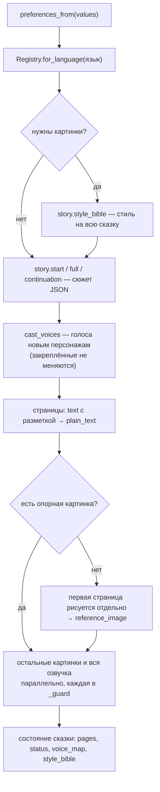

# Конвейер

**Зачем это.** Конвейер превращает бланк в сказку. Он решает, что делать по порядку и параллельно, как держать
один стиль и одни голоса на всю сказку, что делать, если страница не удалась. Разработчик воркера меняет здесь
логику сказки; вызовы моделей — в [провайдерах](07-providers.md).

Код — [pipeline.py](https://github.com/vlad78831457/orb-tale-servo/blob/main/worker/src/taleweaver_worker/pipeline.py),
[story.py](https://github.com/vlad78831457/orb-tale-servo/blob/main/worker/src/taleweaver_worker/story.py).

## Сегмент

Сказка пишется **сегментами**:
- старт — первый сегмент до развилки, в режиме `interactive`, или вся сказка в режиме `narrative`;
- каждое продолжение — следующий сегмент.

## Что сохранено из прототипа

| Приём | Зачем | Где |
|---|---|---|
| **ленивое ветвление** | медиа делается только для выбранной ветки, не для всех вариантов развилки | `continue_` → `_segment` только для новых страниц |
| **опорная картинка** | первая картинка — образец стиля для всех следующих, в том числе в продолжениях | `_media_for`, `reference_image` |
| **фото героев образцами** | модели картинок, которые принимают образцы, рисуют похожих героев; выключатель `HERO_PHOTOS=off` | `start(..., photos)`, `photo_file_ids` |
| **голоса закреплены** | персонаж звучит одинаково всю сказку; голос рассказчика персонажам не даётся | `voice_map`, `cast_voices` |
| **промпты сюжета дословно** | качество прототипа не потеряно | `story.py` |
| **таймаут на страницу** | одна страница не валит сегмент | `_guard` |

## Параллельность и сроки

| Настройка | По умолчанию | Что |
|---|---|---|
| `MAX_CONCURRENT_IMAGE_CALLS` | 3 | картинок одновременно |
| `MAX_CONCURRENT_AUDIO_CALLS` | 4 | страниц озвучки одновременно |
| `MAX_CONCURRENT_TTS_CALLS` | 6 | вызовов TTS на сегмент: страницы × реплики |
| `IMAGE_GENERATION_TIMEOUT_SEC` | 120 | срок одной картинки |
| `AUDIO_GENERATION_TIMEOUT_SEC` | 150 | срок озвучки одной страницы |
| `WORKER_CONCURRENCY` | 2 | сказок одновременно на прораба |

`_guard` сначала берёт место в очереди (семафор) и только потом запускает таймаут. Срок страницы считается от
начала её работы, а не от постановки в очередь. Иначе последние страницы истекали бы, не начав рисоваться.

## Ошибки

| Где | Что | Итог |
|---|---|---|
| `continue_` | сказка не `awaiting_choice`; нет выбора или оба сразу; индекс вне вариантов | `SegmentError` → `DATA_REJECTED` |
| `Story._chat` / `extract_json` | модель ответила не JSON или без нужных полей | `StoryError` → `WORKER_ERROR`, можно повторить |
| `_guard` | таймаут или ошибка одной страницы | страница без картинки или звука, предупреждение в лог, сказка идёт дальше |
| провайдер | сеть, 5xx, ключ | исключение → `WORKER_ERROR` |

## Где менять что

| Хочу | Где |
|---|---|
| сюжет, правила, формат ответа модели | `story.py`: `_rules`, `start`, `full`, `continuation` |
| промпт картинки | `story.py` `image_prompt` |
| порядок шагов, что параллельно | `pipeline.py` `_segment`, `_media_for` |
| поля страницы | `pipeline.py` `_page` + бланк [tale.json](https://github.com/vlad78831457/orb-tale-servo/blob/main/worker/module/forms/tale.json) — обе стороны вместе |
| пожелания из бланка в промпт | `pipeline.py` `preferences_from` + бланк `generate_start.json` |
