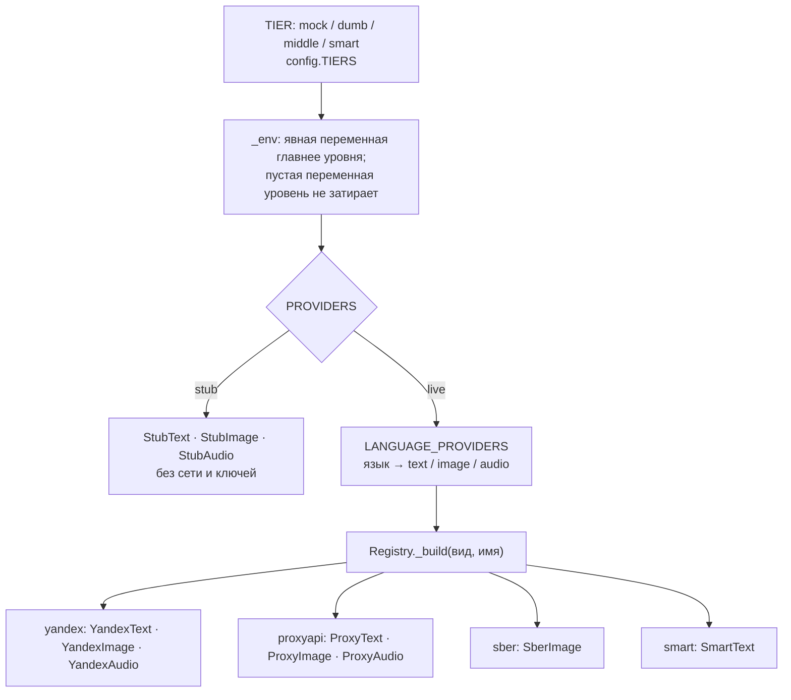

# Провайдеры: до внешнего API

**Зачем это.** Провайдер — единственное место, где воркер выходит в интернет к моделям. Конвейер просит
«текст», «картинку», «голос» через три протокола. Провайдер знает, какой внешний API позвать, с какой моделью,
ключом, таймаутом и запасным путём. Сменить модель или добавить новую — работа здесь.

Код — [providers/](https://github.com/vlad78831457/orb-tale-servo/tree/main/worker/src/taleweaver_worker/providers).

## Протоколы

[base.py](https://github.com/vlad78831457/orb-tale-servo/blob/main/worker/src/taleweaver_worker/providers/base.py):

| Протокол | Метод | Возвращает |
|---|---|---|
| `TextProvider` | `generate(system, user, max_tokens)` | `TextResult(text, tokens)` — токены идут в счёт |
| `ImageProvider` | `generate(prompt, references)` | байты PNG или `None`; `references` — образцы: фото героев, опорная картинка |
| `AudioProvider` | `synthesize(text, voice, model)` | байты аудио |

Общий HTTP-клиент `http_client(total)`: общий таймаут `total`, на соединение 10 с и 3 повтора соединения.

## Выбор провайдера

`Registry.for_language(язык)` выдаёт тройку `Providers(text, image, audio)`. Один экземпляр провайдера на имя
кэшируется.

**Таблица языков по умолчанию** (`DEFAULT_LANGUAGE_PROVIDERS` в
[config.py](https://github.com/vlad78831457/orb-tale-servo/blob/main/worker/src/taleweaver_worker/config.py)):

| Язык | Текст | Картинки | Голос |
|---|---|---|---|
| `ru` | yandex | yandex | yandex |
| `en` | proxyapi | proxyapi | proxyapi |

Заменить — переменной `LANGUAGE_PROVIDERS` (JSON той же формы).

## Уровни прорабов

`TIER` задаёт значения по умолчанию ([config.py](https://github.com/vlad78831457/orb-tale-servo/blob/main/worker/src/taleweaver_worker/config.py) `TIERS`).
Кто какой бланк берёт — решает админ приоритетами ([bhendho/06-tasks](../bhendho/06-tasks.md#выдача-прорабу--claim)).

| `TIER` | Подпись в панели | `PROVIDERS` | Модели |
|---|---|---|---|
| `mock` | «Мок» | `stub` | заглушки: без сети и денег |
| `dumb` | «Глупенькие» | `live` | `YANDEX_GPT_MODEL=yandexgpt-lite`; английский текст и картинки — тоже Яндекс, английская озвучка — ProxyAPI |
| `middle` | «Среднички» | `live` | таблица по умолчанию |
| `smart` | «Умные» | `live` | текст — `smart` (заглушка по общему контракту), картинки и голос — как `middle` |

Неизвестный `TIER` — ошибка запуска (`tier_problem`), без тихого отката на заглушки.

## Каждый провайдер — куда и как

### Yandex Cloud — [yandex.py](https://github.com/vlad78831457/orb-tale-servo/blob/main/worker/src/taleweaver_worker/providers/yandex.py)

| Класс | Внешний API | Транспорт | Модель | Ключи |
|---|---|---|---|---|
| `YandexText` | YandexGPT | `YANDEX_TEXT_TRANSPORT=sdk` (по умолчанию): нативный SDK, gRPC — HTTPS-путь требовал VPN; `openai`: `chat.completions` на `https://ai.api.cloud.yandex.net/v1` | `gpt://<folder>/<YANDEX_GPT_MODEL>`, по умолчанию `yandexgpt` | `YANDEX_API_KEY`, `YANDEX_FOLDER_ID` |
| `YandexImage` | YandexART | `YANDEX_ART_TRANSPORT=openai` (по умолчанию): `images.generate`; `rest`: асинхронная операция на `https://llm.api.cloud.yandex.net` + опрос `/operations/{id}` | `art://<folder>/yandex-art-2.0/latest` | те же |
| `YandexAudio` | SpeechKit v3 | REST `POST https://tts.api.cloud.yandex.net/tts/v3/utteranceSynthesis`, ответ — поток NDJSON-кусков одного WAV | голос по умолчанию `marina` | те же, заголовок `Authorization: Api-Key …` |

Особенности:
- YandexART **не принимает образцы**: фото героев и опорная картинка ему не передаются;
- для OpenAI-совместимого клиента обязателен `project=<folder_id>`.

### ProxyAPI — [proxyapi.py](https://github.com/vlad78831457/orb-tale-servo/blob/main/worker/src/taleweaver_worker/providers/proxyapi.py)

OpenAI-совместимый шлюз `https://api.proxyapi.ru/v1` (`OPENAI_BASE_URL`), ключ `PROXY_API_KEY`, клиент
`AsyncOpenAI` с таймаутом 90 с.

| Класс | Вызов | Модель по умолчанию |
|---|---|---|
| `ProxyText` | `chat.completions.create` | `TEXT_MODEL=anthropic/claude-sonnet-4-6` |
| `ProxyImage` | с образцами — `images.edit` с таймаутом `IMAGE_EDIT_TIMEOUT_SEC` (75 с); завис или ошибка — `images.generate` без образцов | `IMAGE_MODEL=openai/gpt-image-1-mini`, 1024×1024 |
| `ProxyAudio` | `audio.speech.create` | `TTS_MODEL=openai/gpt-4o-mini-tts`, голос по умолчанию `alloy` |

### Sber FusionBrain (Kandinsky) — [sber.py](https://github.com/vlad78831457/orb-tale-servo/blob/main/worker/src/taleweaver_worker/providers/sber.py)

Только картинки, запасной вариант YandexART. Как идёт вызов:
1. `GET /key/api/v1/models` — найти модель `TEXT2IMAGE`;
2. `POST /key/api/v1/text2image/run`;
3. опрос `…/status/{id}`.

Адрес — `https://api-key.fusionbrain.ai`, заголовки `X-Key`, `X-Secret` (`SBER_FUSIONBRAIN_API_KEY`,
`SBER_FUSIONBRAIN_SECRET_KEY`). Чтобы включить, задайте `image: sber` в `LANGUAGE_PROVIDERS`.

### Smart — [smart.py](https://github.com/vlad78831457/orb-tale-servo/blob/main/worker/src/taleweaver_worker/providers/smart.py)

Заглушка по контракту `TextProvider`: пока отвечает как мок. Здесь подключается своя «умная» модель — протокол
и доделка у продавца ([14-recipes](14-recipes.md)).

### Заглушки — [stub.py](https://github.com/vlad78831457/orb-tale-servo/blob/main/worker/src/taleweaver_worker/providers/stub.py)

Детерминированные, без сети. Отвечают **в формате настоящей модели**: JSON сюжета, настоящий PNG, WAV нужной
длины. Весь конвейер на них проверяется честно: разметка, голоса, сборка mp3, счёт. На них работают тесты,
`make e2e` и уровень `mock`.

## Ключи

- Только из окружения прораба. В сборке — `deploy/.env` на сервере: `YANDEX_API_KEY`, `YANDEX_FOLDER_ID`,
  `PROXY_API_KEY`. Вписывает продавец; в Git и в чат они не попадают.
- При старте воркер проверяет настройки (`Settings.problems`) и пишет в лог `provider config: …`. Пример:
  в `YANDEX_FOLDER_ID` вписан ID сервисного аккаунта вместо каталога.

## Как проверить

- `make test` в `orb-tale-servo`: всё на заглушках.
- [tests/live/](https://github.com/vlad78831457/orb-tale-servo/tree/main/worker/tests/live) — настоящие модели с ключами
  из окружения. Тратит деньги, запускается руками.
- На сервере: `TALE_TIER=middle` и ключи в `deploy/.env` → `make up` → сказка на русском и английском.
