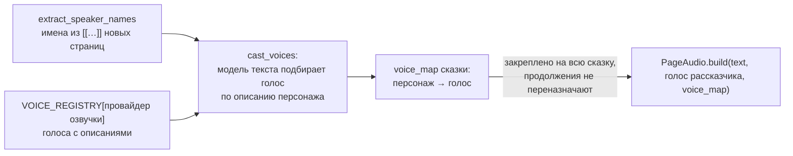

# Озвучка

**Зачем это.** Каждая страница озвучивается одним mp3:
- рассказчик и персонажи своими голосами;
- звуки по ходу текста;
- музыкальные вставки.

Модель сюжета пишет текст со **специальной разметкой**, воркер собирает по ней звук.

Код:
- [audio.py](https://github.com/vlad78831457/orb-tale-servo/blob/main/worker/src/taleweaver_worker/audio.py);
- [markup.py](https://github.com/vlad78831457/orb-tale-servo/blob/main/worker/src/taleweaver_worker/markup.py);
- [voices.py](https://github.com/vlad78831457/orb-tale-servo/blob/main/worker/src/taleweaver_worker/voices.py).

## Разметка текста страницы

| Разметка | Что | Пример |
|---|---|---|
| `[[Имя]]…[[/]]` | реплика персонажа его голосом | `[[Лисёнок]]Как интересно![[/]]` |
| `*звук*` | звук из библиотеки | `*simple_knock_door*` |
| `$музыка$` в начале или конце | музыкальная вставка | `$calm$` |
| остальное | рассказчик | — |

Человек видит `plain_text` — без разметки. Полный `text` хранится в сказке для сборки звука. Звуки и музыка
лежат в образе: [worker/assets/](https://github.com/vlad78831457/orb-tale-servo/tree/main/worker/assets). Модель
получает в промпте список доступных файлов.

## Голоса

- Реестр голосов привязан к **имени провайдера озвучки** (`proxyapi`, `yandex`) — тому же, что в таблице
  языков.
- Голос рассказчика берётся из бланка (`voice`). Персонажу он не назначается никогда.

## Сборка страницы

`PageAudio.build`:
1. `parse_page_text` разбивает текст на куски: рассказчик, реплики, звуки, музыка;
2. реплики одного персонажа озвучиваются **одним запросом** и режутся по паузам. Если число кусков не совпало,
   каждая реплика озвучивается отдельно;
3. вызовы TTS страницы идут параллельно, не больше `MAX_CONCURRENT_TTS_CALLS` на сегмент;
4. склейка, звуки и музыка — `ffmpeg` (есть в образе), в отдельном потоке;
5. результат — mp3. `media.save` даёт адрес `/media/<сказка>/p<N>.mp3`.

## Учёт

Каждый кусок речи прибавляет свою длительность к `meter.tts_seconds`. Звуки и музыка из библиотеки не
считаются. Цена: секунда = 40 токенов = 0,02 GC ([09-accounting](09-accounting.md)).

## Где менять

| Хочу | Где |
|---|---|
| добавить голос | `voices.py` `VOICE_REGISTRY` нужного провайдера |
| новый звук или музыку | файл в `worker/assets/sounds` или `music` |
| правила разметки | `markup.py` и промпты в `story.py` — вместе |
| другой провайдер озвучки | [07-providers](07-providers.md) |
