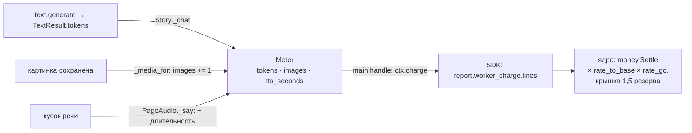

# Счёт прораба

**Зачем это.** Пользователь платит за то, что прораб реально потратил. Прораб считает работу в своих единицах,
ядро переводит их в GC по курсам из паспорта и тарифов. Здесь — откуда берутся числа счёта.

## От вызова модели до GC

| Единица | Когда растёт | Откуда число | Курс |
|---|---|---|---|
| `tokens` | каждый ответ модели текста: сюжет, стиль, кастинг голосов, промпты картинок | `usage` из ответа API. Заглушка считает примерно, 4 символа на токен (`estimate_tokens`) | 1 токен = 0,0005 GC |
| `images` | картинка получена и сохранена; неудачная не считается | `Meter.images` | 1 = 8000 токенов = 4 GC |
| `tts_seconds` | каждый озвученный кусок | длительность аудио | 1 с = 40 токенов = 0,02 GC |

Курсы — в [module.yaml](https://github.com/vlad78831457/orb-tale-servo/blob/main/worker/module/module.yaml),
админ может переопределить их в «Тарифах». В задаче фиксируются курсы, действовавшие при её создании.

## Резерв против факта

| Бланк | Резерв | Типичный факт на заглушках |
|---|---|---|
| `generate_start` | 150 GC | ~13 GC |
| `generate_continue` | 80 GC | по факту сегмента |

На настоящих моделях факт выше: одна картинка — уже 4 GC. Если факт
превысит резерв, ядро спишет до 1,5 резерва. Резерв — обещание «примерно столько», настраивается в «Тарифах».

## ETA — не деньги, а срок

`main.estimate` оценивает время, а не цену. Резерв задаёт паспорт или тариф, срок — прораб
([04-worker-map](04-worker-map.md#eta--estimate)).

## Где в коде

| Файл | Что |
|---|---|
| [story.py](https://github.com/vlad78831457/orb-tale-servo/blob/main/worker/src/taleweaver_worker/story.py) | `Meter`, `Story._chat` — токены |
| [pipeline.py](https://github.com/vlad78831457/orb-tale-servo/blob/main/worker/src/taleweaver_worker/pipeline.py) | `_media_for` — картинки |
| [audio.py](https://github.com/vlad78831457/orb-tale-servo/blob/main/worker/src/taleweaver_worker/audio.py) | `PageAudio._say` — секунды речи |
| [main.py](https://github.com/vlad78831457/orb-tale-servo/blob/main/worker/src/taleweaver_worker/main.py) | `handle`: `ctx.charge` |
| ядро | [bhendho/04-money](../bhendho/04-money.md) — формула и проводки |

## Как проверить

- `make e2e` в `orb-tale-eco`: «списано по факту, осталось … GC».
- [test_tale_e2e.py](https://github.com/vlad78831457/orb-tale-servo/blob/main/worker/tests/e2e/test_tale_e2e.py):
  единицы в счёте — ровно `tokens`, `images`, `tts_seconds`; баланс = 1000 − сумма списаний.
