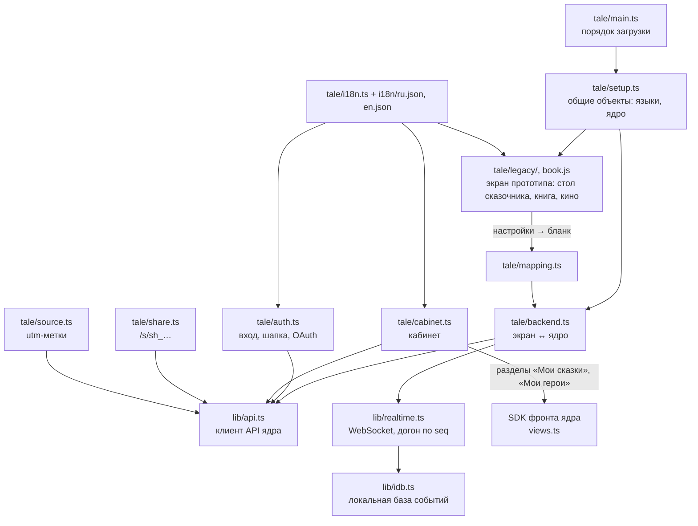

# Экран сказки в коде

**Зачем это.** Экран сказки — то, что видит человек на `/`. Это перенос экрана прототипа, подключённый к ядру:
- герои — факты;
- сказка — задача, результат — факт по версиям;
- кабинет — разметка подразделения.

Здесь видно, какие файлы за что отвечают и куда они ходят.

Код — [screen/src/](https://github.com/vlad78831457/orb-tale-servo/tree/main/screen/src). Как это выглядит —
`docs/SCREENS.md` в снимках `taleweaver-app-vr-ac` (русский) и `vr-ad` (английский).

## Части

| Файл | Что |
|---|---|
| [tale/main.ts](https://github.com/vlad78831457/orb-tale-servo/blob/main/screen/src/tale/main.ts), [setup.ts](https://github.com/vlad78831457/orb-tale-servo/blob/main/screen/src/tale/setup.ts) | запуск: общие объекты для кода прототипа (`window.__TW` — языки, `window.__TWBackend` — ядро) |
| [tale/backend.ts](https://github.com/vlad78831457/orb-tale-servo/blob/main/screen/src/tale/backend.ts) | **связь с ядром**: `createHeroes`, `startTale`, `continueTale`, `loadTale`, `loadShared`, кошелёк, прогресс |
| [tale/mapping.ts](https://github.com/vlad78831457/orb-tale-servo/blob/main/screen/src/tale/mapping.ts) | перевод: настройки экрана ↔ поля бланков |
| [tale/auth.ts](https://github.com/vlad78831457/orb-tale-servo/blob/main/screen/src/tale/auth.ts) | вход и регистрация, шапка: баланс, «Пополнить», «Промокод», внешние входы |
| [tale/cabinet.ts](https://github.com/vlad78831457/orb-tale-servo/blob/main/screen/src/tale/cabinet.ts) | кабинет: разделы по разметке, баланс с историей, профиль, способы входа, «Поделиться», «Удалить» |
| [tale/share.ts](https://github.com/vlad78831457/orb-tale-servo/blob/main/screen/src/tale/share.ts) | страница `/s/…`: сказка только для чтения и «Сохранить к себе» |
| [tale/source.ts](https://github.com/vlad78831457/orb-tale-servo/blob/main/screen/src/tale/source.ts) | метка источника: `utm` из адреса → ядру при регистрации |
| [tale/i18n.ts](https://github.com/vlad78831457/orb-tale-servo/blob/main/screen/src/tale/i18n.ts), [i18n/](https://github.com/vlad78831457/orb-tale-servo/tree/main/screen/src/tale/i18n) | языки: файл на язык; видны только разрешённые бланком |
| [lib/api.ts](https://github.com/vlad78831457/orb-tale-servo/blob/main/screen/src/lib/api.ts) | клиент API: токены в `localStorage` (`offgrid.tokens`), продление, запросы |
| [lib/realtime.ts](https://github.com/vlad78831457/orb-tale-servo/blob/main/screen/src/lib/realtime.ts) | события: снимок, догон по `seq`, без дублей |

Общие файлы `lib/` пока скопированы из фронта ядра. Потом они уйдут в SDK фронта.

## Что экран хранит у себя

| Ключ `localStorage` | Что |
|---|---|
| `offgrid.tokens` | токены входа |
| `taleweaver.lang` | язык экрана |
| `taleweaver.last_tale` | последняя сказка: после перезагрузки откроется она |
| метка источника | первая `utm`-метка |

## Где менять

| Хочу | Где |
|---|---|
| новый язык экрана | `i18n/<код>.json` и язык в бланке `generate_start` (`language.options`) |
| новое поле на «столе сказочника» | экран прототипа + `mapping.ts` + бланк `generate_start.json` + `preferences_from` в воркере |
| кабинет | разметка в `module.yaml` — без кода; баланс и профиль — `cabinet.ts` |

## Проверка

`make test` в `orb-tale-servo`: `tsc` и `vitest` в Docker.
