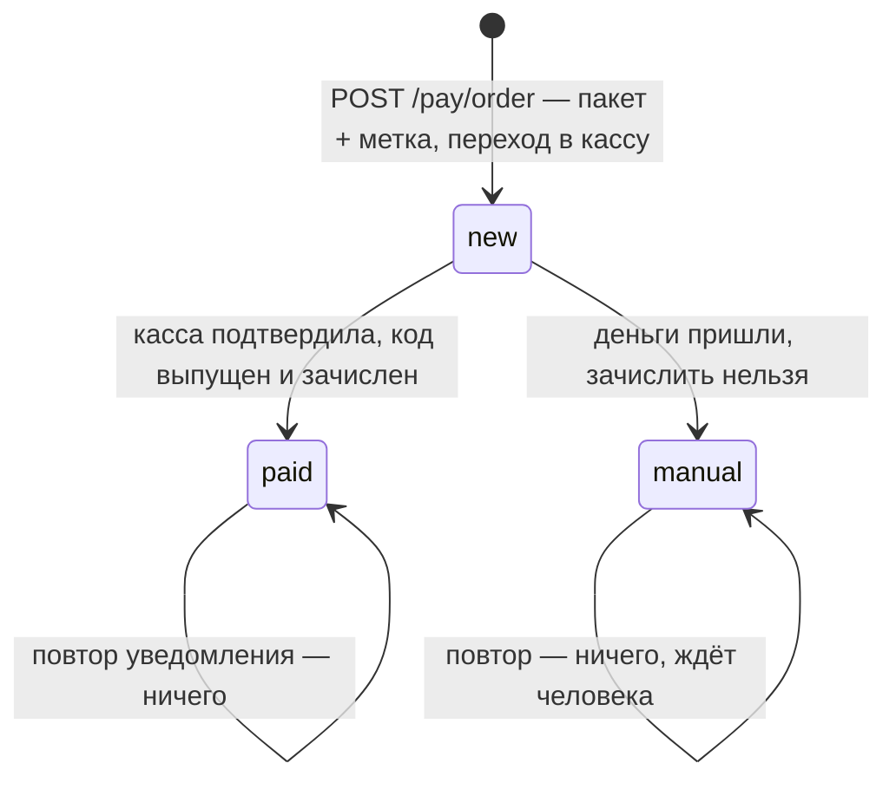
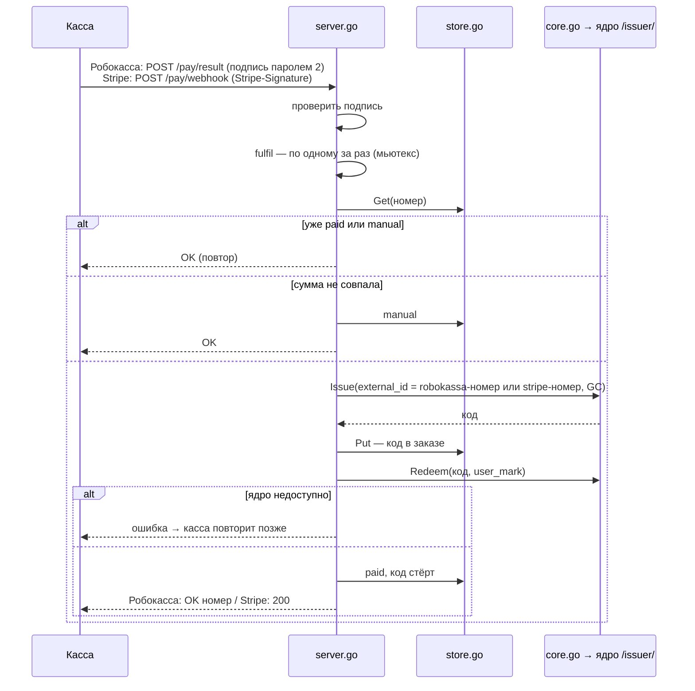

# Оплата: Робокасса и Stripe

**Зачем это.** Служба оплаты — подразделение, которое принимает деньги через кассу и превращает их в GC через
эмитента ядра. Две реализации с одинаковым устройством:
- `orb-tale-pay-robo` — Россия, рубли;
- `orb-tale-pay-stripe` — зарубежный контур, доллары, страницы по-английски.

Обе на Go, только стандартная библиотека. Сторона ядра — [bhendho/11-pay](../bhendho/11-pay.md).

## Заказ

- **Заказ хранится файлом** `<номер>.json` в томе `orders`. Запись атомарная: временный файл и `rename`.
- **Метка `tm_…` остаётся в заказе** и в кассу не уходит. В кассу идут только сумма, номер и описание.
- **Код промокода лежит в заказе** только между выпуском и зачислением — на случай повтора уведомления.
  После зачисления он стирается.
- **`manual`** — неверная сумма, просроченная или чужая метка. Кассе отвечаем «принято», а заказ ждёт
  человека: деньги пришли, GC надо зачислить руками (например, промокодом).

## Уведомление кассы → GC

Ответ «оплачено» касса получает **только когда GC зачислены** или заказ передан человеку. Иначе касса повторит,
а повтор ничего не задвоит: тот же `external_id` → тот же код.

## Отличия касс

| | Робокасса | Stripe |
|---|---|---|
| файл кассы | [robokassa.go](https://github.com/vlad78831457/orb-tale-pay-robo/blob/main/robokassa.go) | [stripe.go](https://github.com/vlad78831457/orb-tale-pay-stripe/blob/main/stripe.go) |
| в кассу | ссылка с подписью `MerchantLogin:OutSum:InvId:Password1` (`PaymentURL`) | Checkout Session через API: `client_reference_id` = номер заказа (`Checkout`) |
| уведомление | `POST /pay/result`, подпись `OutSum:InvId:Password2` (md5 или sha256), ответ `OK<номер>` | `POST /pay/webhook`, событие `checkout.session.completed`, HMAC-SHA256 `t.тело` с допуском 5 минут |
| настройки | `ROBOKASSA_LOGIN`, `ROBOKASSA_PASSWORD1`, `ROBOKASSA_PASSWORD2`, `ROBOKASSA_TEST`, `ROBOKASSA_HASH`, `PAY_PACKAGES` | `STRIPE_SECRET_KEY`, `STRIPE_WEBHOOK_SECRET`, `STRIPE_CURRENCY`, `PUBLIC_URL`, `STRIPE_PACKAGES` |
| страницы | по-русски | по-английски |
| тексты продавца | `pages/` — черновики оферты, возврата, контактов | `pages/` — английские черновики |

## Файлы (одинаковы в обоих)

| Файл | Что |
|---|---|
| `main.go` | настройки из окружения, пакеты `id:GC:цена` |
| `server.go` | страницы `/pay/`: пакеты, заказ, уведомление, success, fail, тексты; `fulfil`, `manual` |
| `store.go` | заказы файлами |
| `core.go` | эмитент ядра: `Issue`, `Redeem`, `MarkOwner` |
| `pay_test.go` | подписи, повторы, сумма, метка, `manual` |

Ссылки: [robo/server.go](https://github.com/vlad78831457/orb-tale-pay-robo/blob/main/server.go), [robo/store.go](https://github.com/vlad78831457/orb-tale-pay-robo/blob/main/store.go), [robo/core.go](https://github.com/vlad78831457/orb-tale-pay-robo/blob/main/core.go), [stripe/server.go](https://github.com/vlad78831457/orb-tale-pay-stripe/blob/main/server.go).

## Как проверить

- `make test` в каждом репозитории оплаты.
- `make e2e` и `make e2e PAY=stripe` в `orb-tale-eco`: поддельная касса подписывает уведомление сама.
- Руками — `MANUAL-TEST.md` снимков: тестовая карта Stripe или подпись `curl`.
