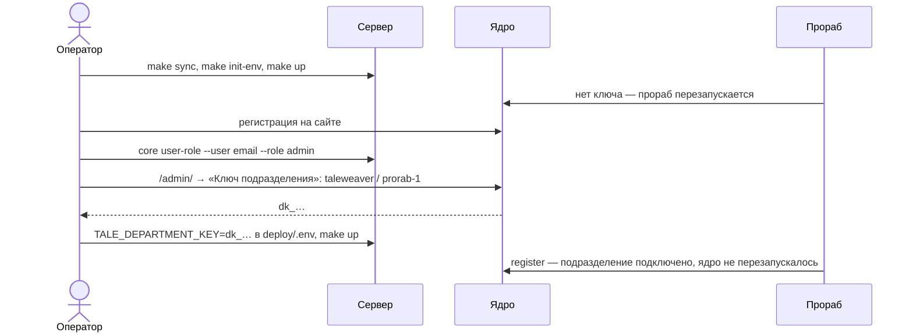
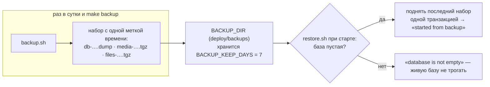

# Эксплуатация

**Зачем это.** Что делать с поднятой системой: запуск, подключение прораба, обновление на ходу, копии, переезд,
стенды и снимки. Пошаговые инструкции для людей — `docs/RUN.md` в снимках vr-ac и vr-ad. Здесь — как это
устроено.

## Команды `orb-tale-eco`

[Makefile](https://github.com/vlad78831457/orb-tale-eco/blob/main/Makefile):

| Команда | Что |
|---|---|
| `make sync` | клоны подрепозиториев по `repos.yaml`; ядро — на тег |
| `make init-env` | `deploy/.env` со случайными секретами, один раз |
| `make up [PAY=stripe]` | вся система; касса — Робокасса или Stripe |
| `make down` | остановить; тома остаются |
| `make backup` | копия сейчас |
| `make e2e [PAY=stripe]` | сквозная проверка в отдельном проекте с одноразовыми секретами |
| `make shots [SHOTS_LANG=en]` | скриншоты безголовым браузером |
| `make status`, `make next-index` | состояние клонов; следующий индекс ветки |

## Первый запуск и ключ прораба



`make shots` делает то же сам: заводит админа и ключ.

## Обновление на ходу

Новая версия прораба или паспорта — пересобрать и перезапустить только `worker`. При старте он заново
присылает паспорт (`register`), ядро обновляет бланки без перезапуска. `make e2e` это проверяет: время старта
ядра после `restart worker` не меняется.

## Копии и переезд



- **Переезд:** скопировать `deploy/backups/` и `deploy/.env` на новый сервер и выполнить `make up`.
- **Уносить копии с сервера** — пока руками (`rsync` каталога). Отдельная служба — в планах.

Код — [deploy/backup/](https://github.com/vlad78831457/orb-tale-eco/tree/main/deploy/backup).

## Стенды и снимки

| Где | Что |
|---|---|
| стенд **ag11** | виртуальная машина директора. Docker поставлен; репозитории заведены на самом стенде, код приезжает по ssh, ключи GitHub на стенд не попадают. vr-ac — порт 3000, vr-ad — 3001. Сейчас остановлены (`make down`), данные в томах |
| снимки vr-ac, vr-ad | копия `orb-tale-*` для друга, с документами `RUN`, `USAGE`, `DEVELOP`, `MANUAL-TEST`, `SCREENS` |

## Логи

```sh
docker compose -f deploy/compose.yaml logs -f worker      # прораб: подключение, provider config, страницы
docker compose -f deploy/compose.yaml logs --tail 50 core worker pay caddy
```
