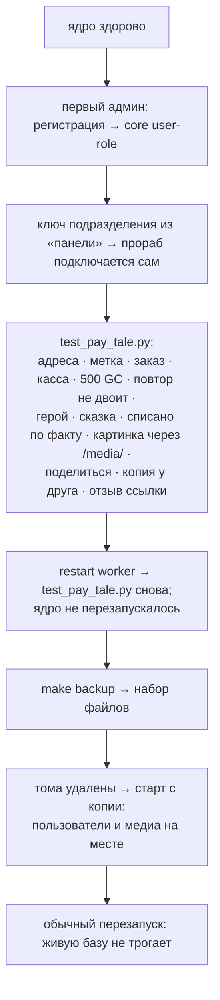

# Проверки

**Зачем это.** В системе три уровня проверок: каждый репозиторий отдельно, вся система сквозь и руками. Здесь —
что проверяет каждая и где она лежит. Всё запускается в Docker.

## Уровни

| Уровень | Где | Команда | Что |
|---|---|---|---|
| ядро | `bhendho` | `make test` | Go-тесты и сквозные на Postgres; SDK; заготовка |
| прораб и экран | `orb-tale-servo` | `make test` | ruff, mypy `--strict`, pytest на заглушках; tsc, vitest |
| оплата | `orb-tale-pay-*` | `make test` | gofmt, vet, тесты подписей, повторов, `manual` |
| сборка | `orb-tale-eco` | `make test` | `repos.yaml`, ссылки, секреты в файлах и истории |
| **вся система** | `orb-tale-eco` | `make e2e`, `make e2e PAY=stripe` | путь человека целиком |
| экраны | `orb-tale-eco` | `make shots` | скриншоты ключевых экранов |
| руками | снимки | `docs/MANUAL-TEST.md` | то же, что e2e, в браузере |
| мануал | `orb-bundam` | `make test` | пути кода в мануале и mermaid-схемы |

## Что проходит `make e2e`

[e2e/run.sh](https://github.com/vlad78831457/orb-tale-eco/blob/main/e2e/run.sh) поднимает систему в отдельном проекте
`tale-e2e` с одноразовыми секретами. `deploy/.env` не читается. После проверки тома удаляются.

48 проверок (Робокасса), 52 — со Stripe: страница на английском, отказ чужой подписи вебхука.

| Файл | Что |
|---|---|
| [e2e/test_pay_tale.py](https://github.com/vlad78831457/orb-tale-eco/blob/main/e2e/test_pay_tale.py) | путь человека; только стандартная библиотека Python |
| [e2e/bootstrap.py](https://github.com/vlad78831457/orb-tale-eco/blob/main/e2e/bootstrap.py) | первый админ и ключ подразделения |
| [e2e/fake_stripe.py](https://github.com/vlad78831457/orb-tale-eco/blob/main/e2e/fake_stripe.py) | поддельный API Stripe |
| [shots/shots.py](https://github.com/vlad78831457/orb-tale-eco/blob/main/shots/shots.py) | 19 экранов Chromium-ом в Docker |

## Отдельно прораб — без всей системы

- [tests/test_pipeline.py](https://github.com/vlad78831457/orb-tale-servo/blob/main/worker/tests/test_pipeline.py) — конвейер на заглушках.
- [tests/e2e/test_tale_e2e.py](https://github.com/vlad78831457/orb-tale-servo/blob/main/worker/tests/e2e/test_tale_e2e.py) — с настоящим ядром: старт, два продолжения, отказ, деньги.
- [tests/live/](https://github.com/vlad78831457/orb-tale-servo/tree/main/worker/tests/live) — настоящие модели, руками, тратит деньги.
