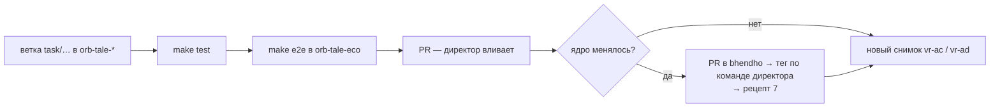

# Рецепты разработчика воркера

**Зачем это.** Типовые изменения по шагам: что трогать и в каком порядке, чтобы экран, паспорт, прораб и ядро
остались согласны. После каждого рецепта — `make test` в изменённом репозитории и `make e2e` в `orb-tale-eco`.

## 1. Добавить поле в бланк старта

Например, «любимое животное».

1. Бланк: [generate_start.json](https://github.com/vlad78831457/orb-tale-servo/blob/main/worker/module/forms/generate_start.json)
   → `"favorite_animal": {"type": "string", "max": 100}`.
2. Воркер: [pipeline.py](https://github.com/vlad78831457/orb-tale-servo/blob/main/worker/src/taleweaver_worker/pipeline.py)
   `preferences_from` — взять поле. Затем [story.py](https://github.com/vlad78831457/orb-tale-servo/blob/main/worker/src/taleweaver_worker/story.py)
   `_rules` — передать в промпт.
3. Экран: поле на «столе сказочника» и [mapping.ts](https://github.com/vlad78831457/orb-tale-servo/blob/main/screen/src/tale/mapping.ts).
4. Перезапустить `worker`: паспорт обновится в ядре сам.

Новое необязательное поле совместимо. Если меняется смысл или обязательность — новая версия бланка (`…v2`) и
`SCHEMA_VERSIONS=1,2` у прораба на время перехода.

## 2. Новая модель или провайдер

1. Класс в `providers/` по протоколу из [base.py](https://github.com/vlad78831457/orb-tale-servo/blob/main/worker/src/taleweaver_worker/providers/base.py):
   - `TextProvider.generate` → `TextResult(text, tokens)` — токены из `usage` ответа;
   - `ImageProvider.generate(prompt, references)` — PNG или `None`; `supports_references`;
   - `AudioProvider.synthesize`.
2. Таймауты — `http_client(total)`. Ключи — новые поля `Settings` из окружения, проверка в `problems()`.
3. Строка в таблицу `Registry._build` ([providers/__init__.py](https://github.com/vlad78831457/orb-tale-servo/blob/main/worker/src/taleweaver_worker/providers/__init__.py)).
4. Включить: `LANGUAGE_PROVIDERS` или новый уровень в `TIERS`.
5. Ключ — в `deploy/compose.yaml` (`${НОВЫЙ_KEY:-}` у `worker`) и `deploy/.env` на сервере. Без первого ключ до
   воркера не дойдёт.
6. Тест на заглушке протокола и, по желанию, в `tests/live/`.

## 3. Своя «умная» модель

[smart.py](https://github.com/vlad78831457/orb-tale-servo/blob/main/worker/src/taleweaver_worker/providers/smart.py)
— `SmartText.generate` по контракту `TextProvider`. Модель обязана отвечать **тем же JSON**, что ждёт `story.py`.
Уровень `smart` уже включает её для текста. Картинки и голос остаются как у `middle`.

## 4. Новый уровень прораба

1. `TIERS` в [config.py](https://github.com/vlad78831457/orb-tale-servo/blob/main/worker/src/taleweaver_worker/config.py):
   `PROVIDERS`, модели, `LANGUAGE_PROVIDERS`, `PRORAB_TITLE`, `PRORAB_DESCRIPTION`.
2. Ключ подразделения на нового прораба (своё имя) и второй экземпляр воркера с `TIER=…`.
3. В панели — приоритеты: кто какой бланк берёт.

## 5. Новая единица учёта

1. `worker_accounting.extra_units` в [module.yaml](https://github.com/vlad78831457/orb-tale-servo/blob/main/worker/module/module.yaml): `{name, rate_to_base}`.
2. Счётчик в `Meter` и `ctx.charge("единица", n)` в `main.handle`.
3. Единица не из паспорта — ядро отвергнет отчёт (`REPORT_INVALID`).

## 6. Новое подразделение (не сказки)

1. Скопировать [templates/department/](https://github.com/vlad78831457/bhendho/tree/v0.3.1/templates/department) в новый репозиторий.
2. Заменить `example` на свой код; бланки; `make check` → `core check-module`.
3. Обработчик `handle` и тест без ядра (`make test`).
4. Сервис в `deploy/compose.yaml` с `CORE_URL`, `WORKER_TOKEN`, `MODULE_DIR`. Ключ — в панели.
5. Разметка `views` — и подразделение появится в кабинете без кода фронта.

## 7. Новая версия ядра

1. Тег в `orb-tale-eco/repos.yaml`, `BHENDHO_SDK_REF` (worker/Dockerfile), `BHENDHO_REF` (screen/Dockerfile).
2. `make sync`, `make e2e`, `make e2e PAY=stripe`.

## 8. Отладка прораба локально

- **Без ядра:** обработчик на заглушках — `tests/test_pipeline.py`; цикл SDK — `fake_gateway`.
- **С ядром:** `make up` с `TALE_TIER=mock`, логи `worker`, трасса задачи в `task_trace`.
- **Модель ответила не тем:** ошибка `StoryError` в логе, задача `WORKER_ERROR`. Смотреть промпт в `story.py`
  и `extract_json`.

## 9. Выпуск изменения до снимка

