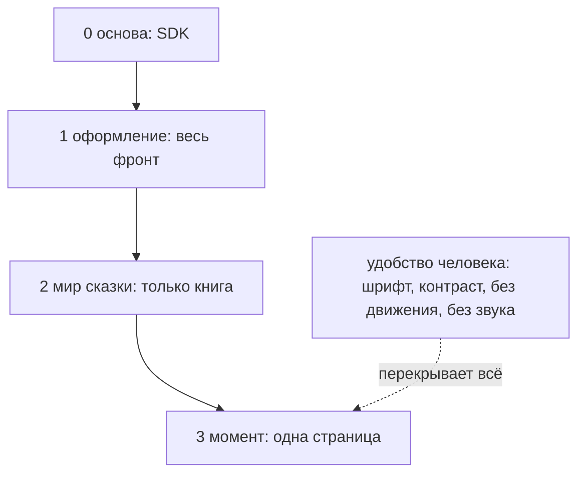

# Атмосфера слоями: что на что влияет, зоны экрана, пресеты героев и миров

Ветка `think/bk-atmosphere-layers`, 2026-10-20. Рассуждение, код не трогаем. Продолжение
[bj-front-skins.md](bj-front-skins.md).

## Ответы директора к bj, 2026-10-20

1. **Делаем оба уровня:** оформление фронта и мир сказки. Смена фронта целиком тоже возможна. Плюс в планах
   **пресеты героев и миров**.
2. **Оформления делаем мы с ИИ.** Пользователь не создаёт ничего, как минимум в `orb-tale-*`.
3. **Насколько глубоко** — надо понять, где и как создавать атмосферу, что на что влияет и как сделать
   **слоистую систему**. Зон у интерфейса несколько: верхний бар и меню, зона настройки и заполнения фактов,
   зона, где читают и погружаются. «Тут надо думать» — это и есть этот документ.
4. **Панель админа остаётся в ядре.**
5. **Приложения в магазинах** — пока гипотеза, никто её не прорабатывал. Цена выше, но юридически как будто
   проще. Идти туда стоит уже с готовым решением: только портировать идеи и искать там пользователей.

## Что уже есть в экране сказки

| Зона | Что в коде (`orb-tale-servo/screen`) |
|---|---|
| Шапка | `.site-header-row`: знак, язык, вход и кошелёк |
| Обложка | `.hero` + `hero-scene`: приветствие, картинка-сцена |
| Стол | `.desk`: настройки сказки (`settings-list`), форма, кнопка «соткать» |
| Книга | `.book`: разворот «картинка + текст», театр во весь экран, звук страницы (`page-audio`) |
| Кабинет | `.cabinet`: мои сказки, мои герои |
| Вход, оплата | `auth-card`, страницы служб оплаты |

**Атмосфера уже делится на слои, только они зашиты в код:**
- цвета — переменные CSS (`--room-bg`, `--page-bg`, `--ink` …), светлые и тёмные;
- рисунок страницы — движок сцен на SVG (`legacy/scene.js`): сцены `forest`, `sea` …, время `day`, `dusk`,
  `night` со своими палитрами. Сцену, время и настроение (`mood`) для каждой страницы выдаёт модель (`worker/.../story.py`, `pipeline.py`), экран рисует по ним.

Получается, что «мир» и «момент» в зачатке уже есть, только палитры и силуэты зашиты в JavaScript.

## 1. Слои: кто что задаёт

Слой выше перекрывает слой ниже, но только в том, что ему разрешено.

| № | Слой | Кто задаёт | Что меняет | Действует |
|---|---|---|---|---|
| 0 | **Основа** | SDK, ядро | сетка, размеры, отступы, доступность, кнопки денег и входа | везде, не меняется |
| 1 | **Оформление** (скин) | человек выбирает, админ задаёт по умолчанию | цвета и фактура интерфейса, шрифт заголовков, орнаменты | на всём фронте |
| 2 | **Мир** сказки | выбирается при создании сказки, хранится в ней | фон и бумага книги, рамка, палитры и силуэты сцен, шрифт текста сказки, звук фона | в книге; на столе — только превью выбранного мира |
| 3 | **Момент** страницы | сама сказка: сцена, время суток, настроение | палитра сцены, частицы (снег, звёзды), звук страницы | одна страница книги |
| ↑ | **Удобство человека** | человек | крупный шрифт, контраст, «без движения», «без звука» | всегда побеждает все слои |

Как это работает технически: переменные CSS наследуются сами. Основа задаётся в `:root`, оформление — на
`[data-skin]`, мир — на `.book[data-world]`, момент — на странице книги. Удобство человека накладывается
классами сверху. Дешевле системы не придумать, и всё это уже умеет любой браузер.



## 2. Зоны: где сколько атмосферы

Главное правило: **атмосфера растёт к книге и затухает к кошельку.**

| Зона | Оформление | Мир | Момент | Почему |
|---|---|---|---|---|
| **Шапка и меню** | только цвета | нет | нет | человек должен узнавать меню в любом мире |
| **Стол:** настройка, заполнение фактов, кабинет | полностью | превью выбранного мира | нет | здесь работают с формой — главное, чтобы было читаемо |
| **Книга:** чтение, театр | фон вокруг книги | полностью | полностью | здесь погружаются |
| **Вход, оплата, ошибки** | только цвета, и то приглушённо | нет | нет | доверие: кнопка оплаты везде одна и та же |

**Отговариваю от атмосферы в зоне денег и входа.** Если кнопка «Пополнить» выглядит в каждом мире по-своему,
человек перестаёт её узнавать. А поддельную страницу оплаты, наоборот, легче выдать за настоящую.

## 3. Чем создаётся атмосфера — словарь

Это то, что слой может задать. Список и есть будущий контракт `skin-v1` / `world-v1`.

| Что | Пример | Оформление | Мир | Момент |
|---|---|---|---|---|
| палитра | `--room-bg`, `--ink`, `--accent` | да | да, внутри книги | палитра сцены |
| фактура | фон комнаты, бумага страницы | да | да | — |
| типографика | шрифт заголовков, шрифт текста сказки | заголовки | текст сказки | — |
| орнамент | рамка книги, разделители (`flourish-row`) | да | да | — |
| сцена | силуэты (лес, море), палитры дня и ночи | — | да | выбор сцены и времени |
| частицы | снег, звёзды, светлячки | — | да | да |
| звук | фон мира, шорох страницы | — | да | звук страницы |
| слова | название и описание мира | имя скина | да | — |

Валидатор проверяет и **матрицу прав**: мир не может поменять шапку, оформление не может тронуть кнопку оплаты.

**Отговариваю менять тексты интерфейса по миру** (например, «Соткать» → «Наколдовать»). Каждую подпись
пришлось бы держать по всем языкам и мирам, а мы ещё не перевели даже подписи кабинета (ADR-72). Пока у мира —
только его название и описание.

Движение и звук **по умолчанию тихие**: звук включается после первого действия человека (браузеры сами не дают
играть звук раньше), движение выключено при «уменьшить движение» в системе.

## 4. Пресеты миров и героев

У **мира две половины:**

| Половина | Что | Для кого |
|---|---|---|
| для глаза | скин мира: палитры, бумага, силуэты, звук | фронт |
| для модели | описание мира: место, законы, тон, чего в нём не бывает | прораб, промпт сказки |

Описание для модели — территория друга: модели и промпты его. **Предлагаю держать обе половины в одной папке
мира, но в разных файлах** (`skin/` и `world.md`), чтобы дизайн и промпты не мешали друг другу. Прораб берёт
только `world.md`.

**Пресет героя** — готовый герой: имя, черты, портрет. Есть два способа:

| Способ | За | Против |
|---|---|---|
| А. Статика в репозитории, при выборе копируется в «Мои герои» | просто; герой проверяется, как скин | копирование надо написать |
| Б. Админ создаёт героя как свой факт и кладёт на витрину; человек нажимает «копия к себе» | уже работает в ядре (поделиться и копия, витрина, ADR-74) | героев придётся создавать через систему, а не файлами |

**Склоняюсь к Б для героев:** ядро ничего нового не требует, и герой сразу живой — с портретом, сделанным
системой. Миры — по способу А, потому что мир — это оформление и описание, а не факт человека.

## 5. Где всё лежит

Предлагаю вместо `orb-tale-skins` из bj — **один репозиторий `orb-tale-worlds`**:

```
orb-tale-worlds/
  skins/<скин>/         оформления фронта
  worlds/<мир>/         skin/ + world.md + превью
  template/  AI.md      заготовки для ИИ и человека
```

Герои по способу Б живут в системе, а не в репозитории.

## 6. Смена фронта целиком

Это слой ниже основы: другой фронт, а не другой скин. Адрес с версией у подразделения уже есть
(`/d/<подразделение>/<версия>/`). Второй фронт — это просто другая версия по другому адресу, и его тоже
можно выбирать. Скины и миры от этого не зависят: если фронт поддерживает `skin-v1`, он их понимает.

## Рекомендация

1. Пять слоёв: основа, оформление, мир, момент, удобство человека — на переменных CSS, с матрицей прав в
   валидаторе.
2. Атмосфера растёт к книге и затухает к кошельку: шапка и оплата почти не меняются.
3. Сначала словарь и матрица прав (контракт), потом два скина и два мира на стенде со скриншотами.
4. Палитры и силуэты сцен вынимаем из `scene.js` в мир.
5. Мир — папка из скина и описания для модели, в `orb-tale-worlds`; герои-пресеты — через витрину и копию.

## Вопросы директору

1. **Зоны:** согласны с четырьмя зонами и правилом «к книге — больше, к кошельку — меньше»?
2. **Мир при создании сказки:** человек выбирает из пресетов, или модель придумывает сама, а пресет только
   подсказывает?
3. **Герой-пресет** после копии можно править у себя — или он неизменный?
4. **Описание мира для модели** (`world.md`) пишем мы или друг?
5. **Один репозиторий `orb-tale-worlds`** для скинов и миров — или раздельно?
6. **Первая проба:** какие два мира? Предлагаю нынешний «сказочный» как основной и `new-year` — к посадочной
   странице.
