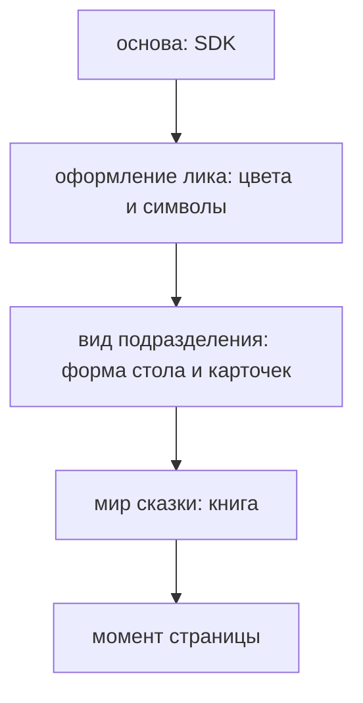

# Стол сказок: разные задачи над одними фактами, рюкзачок, два способа создать сказку

Ветка `think/bm-desk-mechanics`, 2026-10-20. Рассуждение, код не трогаем. Продолжение
[bl-worlds-presets.md](bl-worlds-presets.md). Директор диктовал голосом — это размышления вслух, не решения;
ниже его мысли и мой разбор.

## Мысли директора, 2026-10-20

1. **«Подешевле, подороже» — не уровень прораба.** Идея другая: **по одним и тем же фактам можно поставить
   разные задачи.** Входные факты одинаковые, выходные факты одинаковые, а задачи над ними — разные.
2. **Боковая панель.**
   - Факты и задачи даёт подразделение (у нас — сказки).
   - Кнопки «выполнить такую-то задачу» оформляет само веб-ядро `bhendho-lik-pwa`.
   - Область, где заполняются факты, по дизайну наследуется от подразделения; кнопки задач — от оформления
     лика, то есть всего приложения.
3. **Механика стола — перетаскивание.** С телефона — пальцем, с компьютера — мышкой.
   - Много готовых, предзаполненных предметов. Из одной области их перетаскивают в другую: из набора — в задачу,
     в «рюкзачок».
   - Пример: у героя много характеристик. В задачу на сказку кладём героя и только некоторые его
     характеристики. Можно положить нескольких героев и несколько предметов.
   - Из одних фактов можно собирать другие.
   - Подробно механику сказок надо разобрать отдельно.
4. **Два способа создать сказку:**
   - **подробно** — описываем всех, все поля можно поменять; получается почти свой пресет;
   - **экспресс** — на основе пресета, человек заполняет буквально несколько полей, и по ним ставится задача.

## 1. Разные задачи над одними фактами

Это снимает противоречие из bl: человек выбирает **задачу**, а не уровень прораба. Решение 2026-10-16 («уровень
выбирает админ») остаётся в силе.

В ядре это уже есть:
- у подразделения может быть **сколько угодно бланков задач**, у каждого своя цена (`base_price_gc`, меняется
  в «Тарифах»);
- бланк говорит, какие факты ему нужны: поле `fact_ref` с `expected_fact_kind`;
- для каждого бланка админ выбирает прораба и его уровень (7.3).

Получается так: «Сказка коротко» и «Сказка с картинками и звуком» — **два бланка** над одним героем и миром, с
разной ценой. А «быстрая» и «лучшая» — это прорабы разных уровней, и их выбирает админ, поставив их на разные
бланки. **Нового в ядре не нужно.**

**Как боковая панель знает, какие кнопки показать.** Она сравнивает, что лежит в рюкзачке, с тем, что просят
бланки: подходит бланк — кнопка с ценой есть, не хватает факта — кнопка серая с подсказкой «положите героя».
Всё это фронт может посчитать сам по каталогу бланков. Проверю на шаге, хватает ли того, что каталог отдаёт уже
сейчас.

## 2. Чьё оформление где

| Область | Что | Вид от кого |
|---|---|---|
| бар, меню | навигация, кошелёк | лик |
| **боковая панель задач** | кнопки задач, цена, баланс, подтверждение | **лик**: одна деталь на все подразделения |
| **область фактов**: стол, рюкзачок, карточки | герои, предметы, мир | **подразделение** (сказки) |
| книга | чтение | подразделение + мир |

**Предлагаю одно условие:** вид подразделения строится **на переменных оформления лика**, а не на своих
цветах. Иначе человек выбрал «Новый год», бар стал новогодним, а стол сказок остался прежним. Подразделение
задаёт форму (карточки, раскладку), лик — цвета и символы. Это ещё один слой в схеме bk, между оформлением и
миром:

## 3. Рюкзачок

Рюкзачок — **черновик задачи**: то, что человек собрал на столе, но ещё не запустил.

| Что кладут | Как попадает в задачу |
|---|---|
| героя целиком | ссылка на факт героя (`fact_ref`) |
| героя, но только некоторые черты | ссылка на героя + список выбранных черт полем бланка (`list`) |
| несколько героев, предметы | списки ссылок |
| мир | ссылка на мир; промпт мира прораб берёт сам (bl) |

Черты, которые человек не взял, остаются у героя, а не стираются: в этой сказке их просто нет. Это поле бланка
сказок, ядро здесь ничего нового не делает. Проверено по коду ядра `v0.3.1`: ссылки на факты внутри `list`
проверяются так же, как сверху (`forms/forms.go`, `engine/tasks.go` — `checkTaskRefs`), то есть элемент списка
«герой + выбранные черты» (`fact_ref` + `multiselect`) ядро уже принимает.

**Перетаскивание — да, но не только оно. Отговариваю от перетаскивания как единственного способа:**
- на телефоне перетаскивание спорит с прокруткой: палец тянет карточку — а страница едет;
- маленьким детям и бабушкам точно перетащить трудно;
- без мышки и пальца (с клавиатуры, с экранной читалкой) перетащить нельзя совсем.

Предлагаю три равноправных жеста:

| Жест | Компьютер | Телефон |
|---|---|---|
| перетащить | мышкой | долгое нажатие + движение |
| нажать «в рюкзак» | кнопка на карточке | кнопка на карточке |
| выбрать черты | галочки на раскрытой карточке | галочки на раскрытой карточке |

**Из одних фактов собрать другой** («из предметов — новый предмет», «из двух героев — семья») — это тоже задача
над фактами: бланк, у которого выход — новый факт. Тот же механизм, что у сказки, только на выходе не книга.

## 4. Подробно и экспресс

Это тоже два бланка (или две формы одного), и они хорошо ложатся на пресеты:

| | Экспресс | Подробно |
|---|---|---|
| с чего начинается | пресет с полки | пустой стол или пресет |
| что заполняет человек | 2–4 поля: имя ребёнка, чего хочет сегодня | всё: каждого героя, каждую черту, мир |
| что получается | сказка | сказка **и** свой пресет, который можно сохранить и запускать снова |
| кому | родителю вечером перед сном | тому, кто хочет «своё» |

**Предлагаю начать с экспресса.** Он ближе к первой оплате: меньше полей — быстрее до кнопки «соткать». И
он проверяет полку и пресеты, без которых подробный режим не нужен. Подробный режим — продолжение: «раскрыть
пресет и поправить».

**Голосом.** Директор сам заметил: голосом думается вслух, текстом — коротко. Для экспресса это подсказка:
поле «расскажите, о чём сегодня сказка» голосом, а модель раскладывает сказанное по полям («заполнить по словам»,
bl, шаг W6). Голосовой ввод есть в телефоне сам, ничего своего писать не надо.

## Рекомендация

1. «Подешевле, подороже» — это разные бланки задач над одними фактами, ядро уже умеет. Уровень прораба
   по-прежнему выбирает админ.
2. Боковая панель — лика, область фактов — подразделения, но на переменных оформления лика.
3. Рюкзачок — черновик задачи. Три жеста: перетащить, кнопка «в рюкзак», галочки черт.
4. Сначала экспресс-сказка из пресета, потом подробный режим.
5. Механика сказок подробно — следующим рассуждением, когда директор скажет.

## Вопросы директору

1. «Подешевле, подороже» — это разные бланки задач, а уровень прораба остаётся за админом — так?
2. Перетаскивание плюс кнопка «в рюкзак» и галочки черт — согласны, что нужны все три жеста?
3. Начинаем с экспресса из пресета?
4. Рюкзачок хранится только на устройстве или у человека в кабинете (виден с телефона и с компьютера)?
