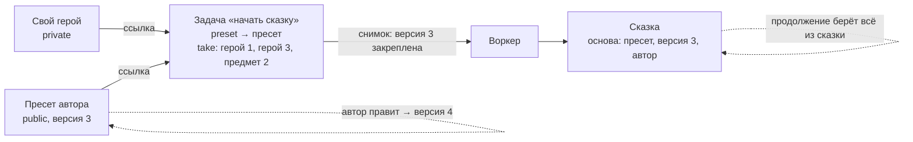

# Публичные факты: пресет по ссылке, а не копией

Ветка `think/bx-public-facts`, 2026-10-23. Это рассуждение, код не меняем. Продолжает разбор бланков
(`orb-tale-eco/docs/FORMS.md`, этап 14, ответы 14.2 в `evo/orb-bundam/PLAN.md`).

## Мысль директора, 2026-10-23

- Пресеты автора **не копировать**, а **ссылаться** на них или брать из них только части, «как бы строчками».
- Зачем: автор не плодит лишних фактов; ни админ, ни родитель не путаются, откуда к ним пришли факты.
- В сказке пишем, что её **основной пресет — вот тот**. Пресет со временем поменялся — ничего страшного,
  новая сказка возьмёт новый.
- В задачу идёт, **что из пресета берём, а что нет** — «факт-маска» по пресету. Либо выбор строкой.
- **Правку ядра делаем.** Надо понять, на какие чужие факты можно ссылаться. Сейчас это только факты админа.
  Факт бывает **приватный** или **публичный**: на приватный ссылается только сам хозяин, на публичный —
  кто угодно.

## Как сейчас

- Ядро при создании задачи проверяет ссылку: факт опубликован, нужного вида и **принадлежит этому
  человеку** (`bhendho`, `internal/core/engine/tasks.go`, `checkTaskRefs`: `f.user_id = $2`).
- Поэтому пресет студии сначала **копируется себе**, а подсказка случая идёт **текстом от экрана**.
- Снимок для воркера ядро делает, когда воркер берёт задачу: тела опубликованных версий фактов и номера
  версий (`materialize`, `gateway.go`). Версия в снимке **закрепляется** — дальше правки пресета на эту
  задачу не влияют.
- Витрина (ADR-74) — это порядок и язык для карусели, а не право ссылаться. Ссылка «поделиться» (ADR-73) —
  чтение по секретной ссылке и копия, тоже не то.

## Предложение: видимость факта

У факта появляется **видимость**: `private` (по умолчанию, как сейчас) или `public`.

Правила ядра (набросок для ADR):

1. Ссылка в задаче проходит, если факт опубликован, нужного вида и он **свой или публичный**.
2. Публичный — это свойство факта, а не места на витрине. На витрину по-прежнему кладёт админ.
3. Снимок закрепляет версию публичного факта на момент взятия задачи — как сейчас со своими.
4. Публичный факт **только читают**: изменить, архивировать, сжать его может лишь хозяин.
5. Файлы публичного факта (обложка, портреты) — чтение по подписанной ссылке тем, кто на него сослался,
   собственником остаётся хозяин (как в ADR-42).
6. Список публичных фактов вида X — открытый запрос для экрана (полка), без чужих приватных полей — их нет:
   публичный факт виден целиком.
7. Сделал факт приватным обратно — новые ссылки не проходят; старые сказки не ломаются, у них свой снимок.

## Маска «что берём из пресета»

Список в списке ядро не принимает (ADR-35). Поэтому маска — **выбор нескольких из готовых ячеек**:

| Поле задачи | Тип | Пример |
|---|---|---|
| `preset` | ссылка на факт (свой или публичный) | пресет «Лесная дорога» |
| `take` | выбор нескольких: `hero1` … `hero7`, `item1` … `item5` | `hero1`, `hero3`, `item2` |
| `characters[].traits` | строка, как решили в 14.2 | «смелый; любит яблоки» |

Ядро проверяет `take` само (это обычный `multiselect`). Свои герои человека — ссылками, как сейчас.
Строкой («беру Ивана и клубок») тоже можно, но тогда ядро не проверит, и ошибка всплывёт у воркера.

## Что меняется

- Копия пресета себе исчезает. Полка показывает публичные пресеты сразу.
- В сказке поля `preset` (ссылка) и `preset_version` — родитель и админ видят основу и автора.
- Учёт авторов — по ссылке на факт, а не по коду строкой. Поле `author` остаётся для показа.
- Случай (`occasion`) студии тоже делается публичным — подсказка пойдёт от студии, а не от экрана.
- Мир (`world`) — тоже может стать ссылкой на публичный факт мира, а не кодом строкой. Это и снимает
  открытый вопрос 6.

## Вопросы директору

1. **Кто может сделать факт публичным?** Только админ (просто и безопасно) — или любой человек (тогда это
   уже обмен между людьми, нужна модерация)? Совет: пока только админ.
2. **Мир в пресете** — ссылкой на публичный мир вместо кода? Совет: да, раз ядро всё равно правим.
3. **Маска** — ячейками `hero1…item5` (ядро проверяет) или строкой? Совет: ячейками.
4. **Копии, которые уже есть**, — не переносим: базы перед 14.3 очищаются (решение 14.1).

## Где работа

- `bhendho` (строгий): ADR-79 «Публичные факты», миграция (столбец видимости), проверка ссылок, файлы,
  открытый список, переключатель в панели админа. Отдельным PR с отчётом.
- `orb-tale-servo`: бланки пресета, задачи и сказки (новые версии), полка без копии.
- В плане — шаг 14.3 бланков разбивается: сначала ядро, потом бланки.
